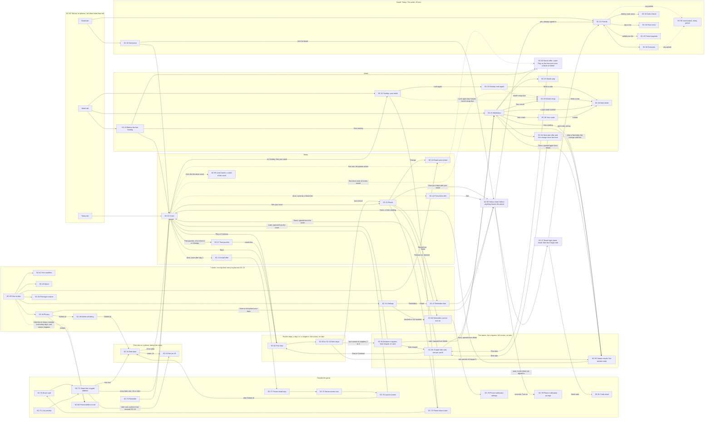
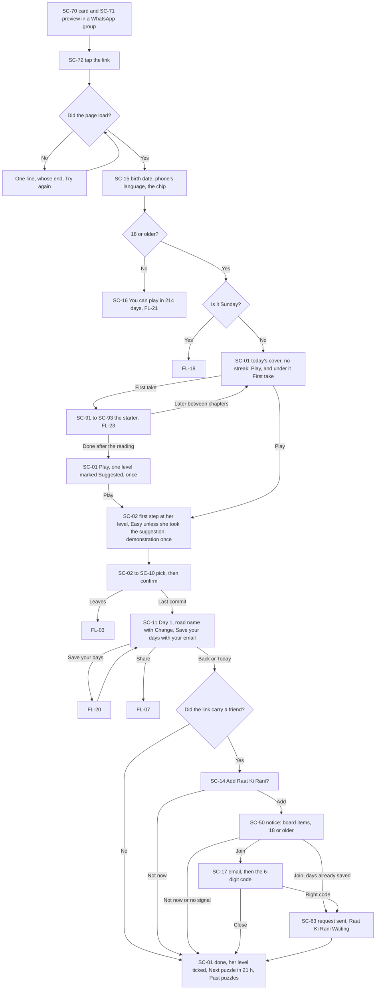
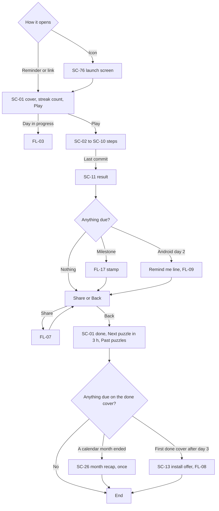
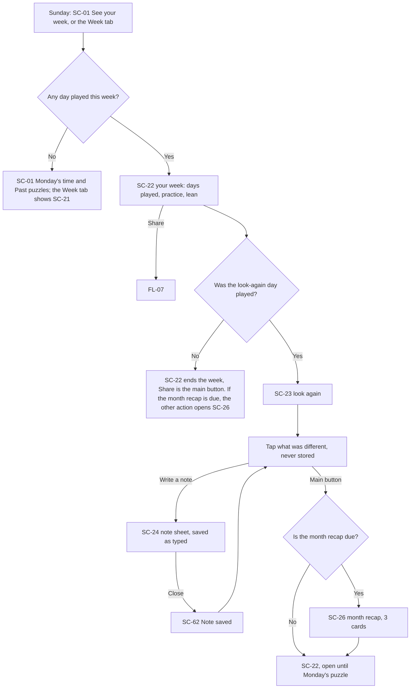
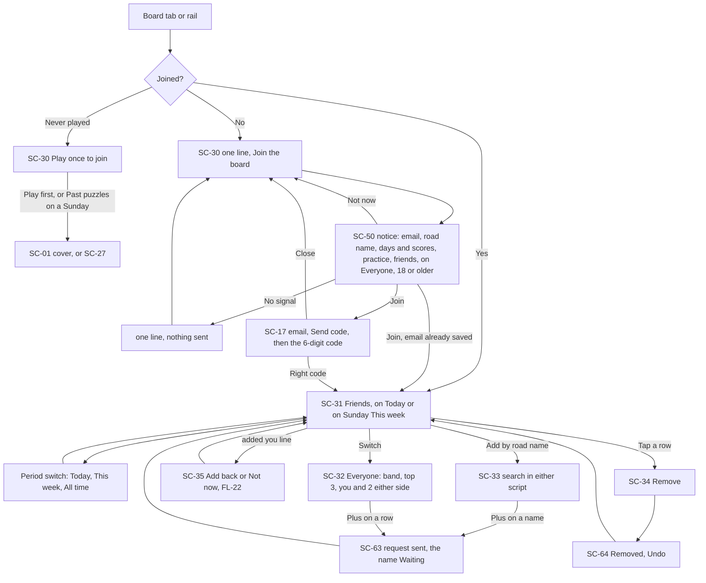
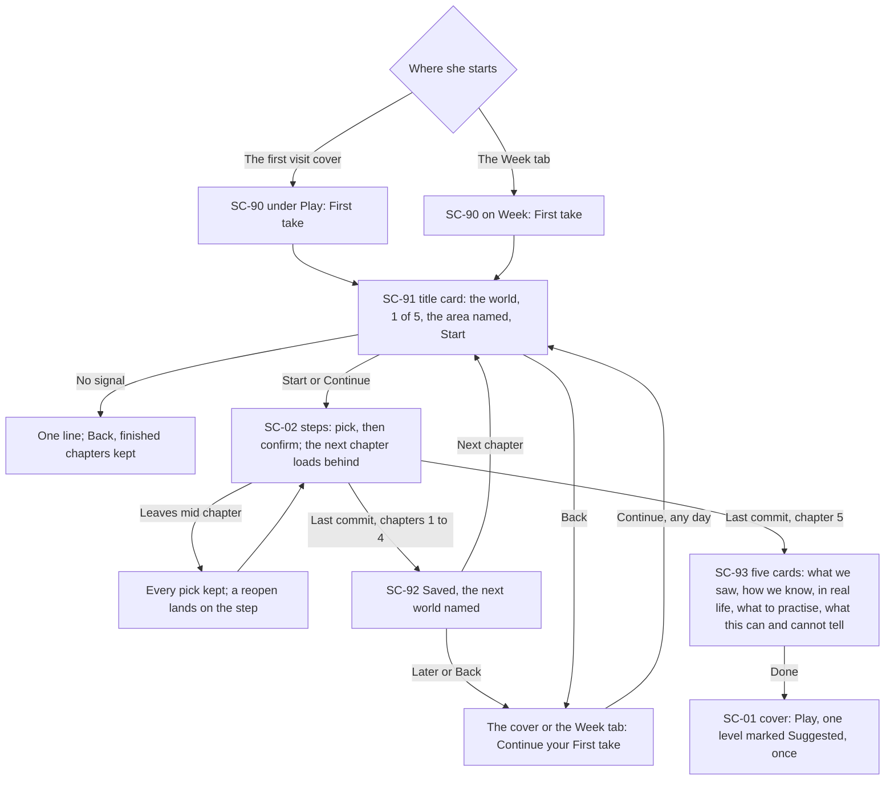
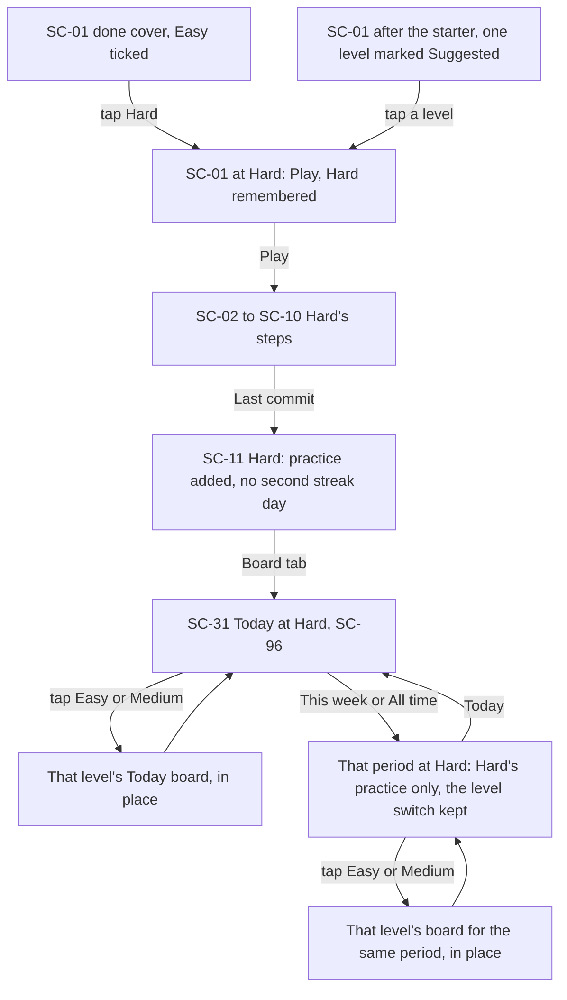

# Retake: screen map and user flows

## How to read this

- **What this is.** Stage 3 of the owner's order (personas and journeys, features, then this, then the design system, then the app). Every place a player can be has an id, SC-00 to SC-96, numbered by area, so the gaps in the numbers are deliberate. The flows FL-01 to FL-26 are built only from these ids.
- **Other ids.** F-01 to F-173a are the features in [feature-set.md](feature-set.md), with the ids added on 21 Oct 2026 for the owner's answers (F-14a, F-14b, F-49f, F-71a, F-78a, F-85a) and the rows rewritten for them (F-14, F-49a, F-89, F-90, F-172). F-201 to F-218 are the features for O12 (the starter, the three levels, the five worlds and the new kinds of decision), added to the feature set at the same time as this file's rows for them, with F-214 rewriting F-10's two-world alternation. R-... rules and the owner's decisions O1 to O17 are in [the consolidated rules](../reference/design-rules-consolidated.md). P1 to P6, S1 to S15 and M1 to M5 are in [personas.md](personas.md) and [journeys.md](journeys.md). s-001 to s-094 are the 94 phone frames of the component library as captured on 21 Oct 2026; the A/B frames s-090 to s-094 are open look choices, not screens.
- **Owner answers.** The owner answered the feature set's Q1 to Q9 and this map's Q10 to Q12 on 21 Oct 2026 (O11 in the consolidated rules), so no screen or step here is conditional any more. The Board, the notice sheet, friends and reminders are in V1. Where an answer cites "Q2 B" or "Q7 B", it names that answer. The same day the owner set O12: an optional 20-minute starter in V1 as the way people start (five chapters of about 4 minutes, one per world), whose private results do say which way a player leans; three dailies a day, Easy, Medium and Hard, each level with its own Today, This week and All time boards; five worlds that the dailies rotate through, one a week; and new kinds of decision (Believe, Split, the batting order), each first in its home world, then in any world (Q15).
- **The First take review (O16, 22 Oct 2026).** The owner's words: "Add hard topics in every chapter... these are adults." Every starter chapter now carries one hard topic, still the situation and never the harm (F-41). So every chapter's title card names its setting before Start (SC-91), and every chapter's "?" holds the help line on its title card and its steps, not only Lugdi's (SC-40, FL-23, F-47). The cast grows by ten, one woman and one man in each world, each only in their own world (F-43, F-207); the results keep fewer words on screen (F-203); road names show as typed, in English letters (F-80). The rest of O16 changes words, not screens, but for answer 7, when a Next take opens, which the owner settled in the second round (O17, answer 6, rule B): on the 1st of the month after the last reading, and never sooner than 28 days on, always with the next month's set, so it never waits for one (SC-94, FL-24).
- **Defaults set for those answers.** The coordinator set eighteen defaults where the answers left a detail open: D1 to D9 for O11 and D10 to D18 for O12. Each is **Decided (default, owner to confirm)**, except D13, which the owner has since settled, and the text cites each by number:
  - D1. The birth date stays on the phone. Only "18 or older" goes to our side, and only when the player joins the Board. For someone under 18 nothing is sent or kept on our side; the phone keeps only the day the game opens for them.
  - D2. Under 18: the day count in one line ("You can play in 214 days"), worked out on the phone; nothing to play, no Board, no email offer.
  - D3. The email login is never needed to play. It is needed to join the Board and to move phones. Reminders do not need it.
  - D4. The code is 6 digits by email, valid for 10 minutes; "Send again" has no ticking counter (O9); one line says the game never asks for this code anywhere else. No passwords and no phone numbers, ever.
  - D5. Today ranks today's score; This week and All time rank practice. The lean is on no board (O5). A past puzzle adds to All time only, never to Today, This week or the streak.
  - D6. Past puzzles open from the cover once today's puzzle is done, and on Sundays: the past days not yet played, newest first. A past day is held back for 7 days after the player plays its twin, so the two halves of a hidden pair never come close together.
  - D7. Adding a friend shows "Raat Ki Rani added you" on their Friends list, with Add back and Not now; until they add back, the adder sees the name as Waiting. No push notification.
  - D8. The month recap opens on the first visit after the calendar month ends.
  - D9. Delete all also deletes the email login and everything on our side.
  - D10. The first-visit cover keeps Play as its one main button and offers the starter as a quieter second action under it ("First take"); after that the starter lives on the Week tab ("First take") until taken, then as the monthly "Next take" there.
  - D11. Starter results are private: never shared, no share card, never on a board, kept on the phone like picks and notes.
  - D12. The starter adds no practice and does not count for the streak; a day counts for the streak if any one of the three levels is played.
  - D13, settled by the owner on 21 Oct 2026 (O12, boards by level). This week and All time are kept separately for each level, as Today is, so Easy, Medium and Hard each have three boards; a level's score and practice count only on that level's boards. This replaces the default's "count every level together".
  - D14. New players start on Easy; after the starter the game suggests a level once; the choice is remembered and changed on the cover.
  - D15. "Level 3 of 6" on covers goes, because "level" now means Easy, Medium or Hard; the calendar getting harder is not shown as a number.
  - D16. The five worlds run in this order, then repeat: Lugdi, Station, Jadugar, Cricket, Rukavat.
  - D17. Chapters save as they finish; a player can stop between chapters and come back; the reading appears only after all five.
  - D18. The starter's reading becomes the starting point of the daily lean, so the daily numbers are steady from day one.
- **From the research line.** Two things O12 needs are owed to the research line and not decided here: how many decisions each chapter needs for a confident reading, and what the evidence says actually helps people unlearn, which the results' advice must follow. A third follows from F-58's caution: how big a change between two readings must be before the Next take names it. Each place that waits on one says "from the research line".
- **Every world.** One row covers all five worlds, Lugdi, Station, Jadugar (the travelling magic show), Cricket (the stadium scoreboard) and Rukavat (रुकावट, the family TV, named after its interruption card; the broadcaster's name and logo never appear), because a world changes the dress and never the places (R-VIS-16, O12, which replaces O7's two-world alternation).
- **Words on screen.** The starter is never called a "test", and nothing on screen calls it a reading of "attitude" or "bias" (O12). The game is called Retake (रीटेक) everywhere a player sees a name, and The Equal Lens is only the small credit in About (O13, O6). The starter is the "First take" and each monthly redo the "Next take" (O13); "starter" stays only as this file's internal name. The starter's results (SC-93) are the one place that says which way a player leans (O12); everywhere else O5 holds.
- **Decided here.** Where the rules left a navigation point open, this file settles it, says "Decided here" and names the rule it follows. Nothing here overrules an owner decision or a binding rule; where a point bends a rule, it is marked "FLAG for the coordinator".
- **Not here.** How each screen looks is stage 4 and [DESIGN.md](../../DESIGN.md). Later screens are listed after the inventory, outside the V1 map.

## The shape in one paragraph

On a phone the game has three tabs, Today, Board and Week, in a fixed bar at the bottom (R-TAB-1); on anything wider than tall a 96 px rail on the left holds the same three in the same order, and the game sits in a column on the right over the full painting (DESIGN Larger screens). A phone's very first visit opens on one birth-date screen (SC-15), the only screen ever placed before the cover (O11 Q6, which overrides R-COVER-1 on a first visit only); someone under 18 stays on a screen that says in how many days they can play (SC-16), and everyone else goes on to the cover. Today opens on the cover, the home and the first screen of every later visit that starts from a link (R-COVER-1, F-01). Play turns the day into a full-screen sequence with no tabs: one puzzle step after another, back at the top left and "?" at the top right (R-TOP-1), until the last commit lands on the result, where the tabs come back. Under Play, the first-visit cover offers the starter as a quieter second action (SC-90, D10): five chapters of about 4 minutes, one in each world, each a full-screen sequence like a day that opens on its title card (SC-91) and ends on a between-chapters screen (SC-92) where the player can stop, and after the fifth a short sequence of cards with the player's private reading (SC-93); after the first visit the starter lives on the Week tab, and later the monthly Next take (SC-94). From the first done cover, a level switch on the cover (SC-95) picks Easy, Medium or Hard, three dailies with their own Play, Continue and done, and the Board has the same switch on all three periods, because each level keeps its own Today, This week and All time (SC-96, D13). The first result offers to save the player's days with an email and a 6-digit code (SC-17); the Board and a new phone need it, and play never does (D3). Once today's puzzle is done, and on Sundays, the cover also opens Past puzzles (SC-27), the earlier days this player has not played (D6). Sunday has no puzzle of its own, so the cover's button opens the week. The Board ranks Today, This week and All time, among friends who have added each other back or among everyone who has joined. The "?" sheet is the one settings place (R-SHEET-4): it opens on how to play today's puzzle, and one level below it holds Settings, Road name, Privacy, Your numbers and About. From any screen with a top bar but the birth-date screen, "?" is one tap; from any tab screen, the other tabs are one tap; back is one tap on every full screen and sheet level. The language chip is one tap too, but only from the cover and the birth-date screen (R-LANG-1; FLAG under Navigation rules).

## Screen inventory

Kinds: **frame** (on every screen), **tab screen** (the tab bar or rail shows), **full screen** (no tabs, back at the top left), **sheet** (rises from the bottom over a scrim), **sheet level** (a view inside the "?" sheet), **menu** (opens on a row), **dialog**, **toast**, **outside** (drawn by WhatsApp, the phone or the browser, or the entry that leads in).

| ID | Name | Kind | Reached from | Leaves to (and what Back or Close does) | Features hosted | Drawn? | States |
|---|---|---|---|---|---|---|---|
| SC-00 | The frame: top bar, tab bar, rail | frame | always present | Today, Board, Week by tab (phones) or rail (wider than tall); a tab always opens at its root (Decided here); hidden on SC-02 to SC-10, SC-15, SC-16, SC-23, SC-26, SC-91 to SC-93 (Decided here: SC-23 and SC-26 are short full-screen tasks, so the bar and the rail hide there too (HIG-H34); R-TAB-1 hides it on puzzle steps and does not say only there; SC-15 and SC-16 come before the game opens, so nothing the tabs lead to is there yet; SC-91 to SC-93 are the starter, a full-screen sequence like a day) | F-10, F-214, F-218, F-11, F-16, F-54a, F-117, F-133, F-137, F-138, F-142, F-143, F-144, F-145, F-146, F-147, F-149, F-150, F-152, F-153, F-156, F-158, F-159, F-162, F-168 | s-001 "Lugdi week / Wednesday, issue 214" and s-002 "Station week / The same day, the same places" show the skeleton; the tab bar is in every tab frame; the rail is not among the 94 frames; the three new worlds' dress is not drawn | each world's dress, the week's world on every tab screen (five, in D16's order); phone; tablet upright; wider than tall (rail, right column); short and wide; Hindi; 200% text; 360 x 640; reduced motion; more contrast; keyboard focus; phone cannot save (one line in place, play goes on) |
| SC-01 | Cover | tab screen (Today root) | SC-15 on a first visit; SC-72 link or typed address, SC-74 reminder, SC-76 launch on every later visit; the Today tab; Back from the first step, from SC-11 or from SC-27; Done on SC-93 after a fresh reading; Later or Back on SC-91 or SC-92 when the starter was opened from the cover | SC-02 (Play, Continue, at the level showing); SC-91 (the starter offer, SC-90, on the first-visit cover only: "First take", a quieter text action under Play, D10, O13, or "Continue your First take" once begun); the level switch (SC-95) changes the cover in place; SC-11 (See your score, at the level showing); SC-22 (Sunday: See your week); SC-27 (Past puzzles: the other action once today's puzzle is done and on a Sunday, the one action on a Sunday with nothing played this week); SC-40 ("?"); the language chip stays on the cover; SC-26 opens, or SC-13 or SC-14 rise, over a done cover; phone back leaves the game | F-01, F-02, F-03, F-04, F-05, F-06, F-08, F-09, F-49a, F-63, F-64, F-77a, F-118, F-134, F-135, F-155, F-161, F-164, F-165, F-170, F-171, F-173a, F-201, F-210, F-211, F-213, F-214 | s-033 "Lugdi cover / The home. Play."; s-041 "Station cover"; s-034, s-042 "mid-puzzle / Continue."; s-035, s-043 "after today"; s-036, s-044 "first visit"; s-037, s-045 "a hard day"; s-038, s-046 "a forgiven day"; s-039, s-047 "loading"; s-074, s-075 Hindi; s-078, s-079 200%; s-088 360 x 640. Sunday states not drawn. Every drawn cover carries "Level 3 of 6" (the hard-topic days "Level 4 of 6"), which goes (D15); the starter offer, the level switch and the three new worlds' covers are not drawn | Play; Continue; each level's own Play, Continue and done, shown by the level switch (SC-95, F-210), with no level number and no "Level 3 of 6" (D15); an earlier day unfinished (Continue, the day named); done at the level showing (See your score and "Next puzzle in 3 h", never ticking, with Past puzzles as the other action while any past day at that level is open to play, D6); first visit, after SC-15, until this phone's first daily result (Decided here: the first-visit cover lasts until then, so a player who stops the starter finds it where she began it): no streak, Play the one main button, "First take" under it as a quieter text action (SC-90, D10, O13), "Continue your First take" once begun and gone once it is finished, Easy set and no level switch until then (D14; Decided here: one main button and one quieter action, D10, and a newcomer has nothing yet to choose a level by); the first cover after a fresh starter reading (Play, and the level switch with one level marked "Suggested", once, D14); done at one level (that level ticked on the switch, the others still open to play); after a restart (Play, no count until today's result); hard-topic day (dowry, custody, safety); first forgiven day; loading (ground and title first); not loaded (one line, whose end, Try again); Sunday (See your week, Past puzzles the other action); Sunday first visit, and Sunday with nothing played this week: Monday's time and "Past puzzles" as the one action (opens SC-27), how to play staying in "?"; on a Sunday first visit the starter offer sits under Past puzzles as on any first-visit cover (Decided here); no level switch on any Sunday cover, which has no daily (Decided here); the first done cover after a calendar month ends (SC-26 opens once, D8); fresh start (new phone, browser cleared, after Delete all: SC-15 first); the day changed while open (worked out again: a done cover becomes today's cover with Play); phone cannot save |
| SC-02 | Puzzle step: the shared skeleton, for a day at any level and for the starter's chapters | full screen | SC-01 Play or Continue; a row on SC-27 (a past day); SC-91 Start or Continue (a starter chapter); the previous step's commit; a reopen of a day or a chapter in progress | the next step (commit); SC-11 (last commit); in a starter chapter, SC-92 (last commit of chapters 1 to 4) or SC-93 (last commit of chapter 5); Back: the previous step, read-only; Back from the first step: SC-01 reading Continue, for a past day SC-27 with its row reading Continue, for a chapter SC-91 reading Continue; "?": SC-40. No close control, no confirm on leaving | F-202, F-213, F-36a, F-12, F-17, F-18, F-19, F-20, F-21, F-22, F-23, F-24, F-25, F-36, F-37, F-38, F-38a, F-39, F-40, F-41, F-41a, F-43, F-46, F-49b, F-49c, F-49d, F-141, F-148, F-157, F-163 | s-001, s-002 skeleton; s-072, s-073 "Hindi step"; s-076, s-077 "200% step / One column; the body scrolls with a cue."; s-086, s-087 360 x 640 | arrive (not ready); picking; armed; refused (shake, reason in 4 words); ready; committing (200 ms); revisited (read-only, a lock, one button back to the current step); ghost demonstration on a first meeting (still under reduced motion), in a starter chapter too, and never again for that kind in a daily (F-25); first-target pulse; hard-topic day (dowry, custody, safety); a level's day (the same skeleton at Easy, Medium and Hard; the level is not named on the step, F-213); a starter chapter (Decided here: the five chapter marks in the kicker's place, with no level, no streak and no day; the chapter's world dresses it whatever the week's world is); the Lugdi chapter, safety and justice, counts as a safety day for "?" (Q7 B, Decided here); offline (plays on; a chapter plays on once it has loaded); scrolls once with a cue (small phone, 200%) |
| SC-03 | Pick, and the loaded-words pick | full screen (a step) | the SC-02 sequence | the SC-02 sequence | F-28, F-42 | s-003 "Lugdi, not ready / The button says what is missing."; s-004 "Lugdi, picked / The button names what happens."; s-005 "Station, picked"; s-006 "Station, committing" | as SC-02 |
| SC-04 | Rule, then jobs | full screen (a step) | the SC-02 sequence | the SC-02 sequence | F-27 | s-007 "Lugdi, rule / The chips carry the key"; s-008 "Lugdi, jobs / Arjun is held; the lit slot takes him."; s-009 "Station, rule"; s-010 "Station, the chart" | as SC-02; the locked rule stays in view as a stamp |
| SC-05 | Checks from a shared budget | full screen (a step) | the SC-02 sequence | the SC-02 sequence | F-29 | s-011 "Lugdi / Spent checks are red stamps."; s-012 "Station / Spent checks are holes through the ticket." | as SC-02; checks left shown as marks |
| SC-06 | Team under a named voice | full screen (a step) | the SC-02 sequence | the SC-02 sequence | F-30, F-42 | s-013 "Lugdi / The team sheet; two of three picked."; s-014 "Station / Departure rows with flap numbers." | as SC-02; team full (refused) |
| SC-07 | Rank, and the batting order | full screen (a step) | the SC-02 sequence | the SC-02 sequence | F-31, F-217 | Not drawn | as SC-02; a placed item tapped returns; the batting order in Cricket: who goes in first, and who captains, on the Rank column (F-217) |
| SC-08 | Word bank | full screen (a step) | the SC-02 sequence | the SC-02 sequence | F-32 | s-017 "Lugdi / A reader's letter with one blank."; s-018 "Station / A luggage tag with one blank." | as SC-02; a filled blank tapped empties |
| SC-09 | Quick sort | full screen (a step) | the SC-02 sequence | the SC-02 sequence | F-33 | s-015 "Lugdi / Meena aunty's column on the paper stack."; s-016 "Station / The notice board stack." | as SC-02; Keep and Cut buttons beside the swipe |
| SC-10 | A new kind of puzzle, Believe and Split among them | full screen (a step) | the SC-02 sequence | the SC-02 sequence | F-35, F-215, F-216 | Not drawn (each kind is drawn before its day, R-STEP-14) | as SC-02; taps and pictures only, no typing, no sound; Believe in Jadugar (two people tell the same story: whom do you believe?, F-215); Split in Rukavat, the family-TV world (the chores and the TV time shared between household members, F-216); each first appears in its home world, then may appear in any world (Q15), so each is drawn in all five worlds' dress |
| SC-11 | Result | tab screen (Today, one level down) | SC-02's last commit, today's or a past day's; SC-01 See your score | Share: SC-73; Change: SC-12 (first result); "Save your days with your email": SC-50 with the save items, then SC-17 (this phone's first result, until saved); Remind me: SC-47, or SC-48 if blocked; the tabs; Back or phone back: SC-01 done at the result's level, for a past day too (Decided here: the commit is the point of no return, R-STEP-7, a played day never reopens, F-49a, and a past day's result goes back to the cover like every result, so no screen sits two deep) | F-05, F-50, F-50a, F-51, F-52, F-53, F-54, F-55, F-56, F-62, F-64, F-72, F-78, F-78a, F-80, F-98, F-99, F-127, F-154, F-163, F-172, F-206, F-210, F-212, F-218 | s-021 "Lugdi result / The score in the issue roundel"; s-022 "Station result / The ticket stamped"; s-055 "Day 1 result"; s-080, s-081 200%; s-089 360 x 640; the three new worlds' result objects and big moments (F-218) are not drawn | reveal (at most 1.2 s, a tap skips); settled; a level's result (the kicker names Easy, Medium or Hard; the score ranks on that level's Today board, F-212, D13); the day's first result at any level moves the streak (D12); a later level's result the same day adds practice (D13) but changes no streak and shows no milestone stamp and no Remind me line (Decided here: one day, one stamp, one offer); Day 1 (pulled towards zero, one line once; after a starter reading the lean starts from that reading instead, D18, F-206, still a number with no side, O5); first result on this phone, today's or a past day's (road name with Change, and "Save your days with your email", F-78a; FLAG under Offers); saved (the offer replaced by one line in place, no toast); a past day (the score, three figures and the line, the lean as a number; no streak change, no milestone stamp, no Remind me line; it adds to All time only, D5; Share carries that day's number); Remind me line (Android day 2; iPhone first result in the installed app; inside another app's browser it waits for a visit in the phone's own browser, as SC-13 does, until the M4 check); opened again from See your score: settled, with no reveal, no stamp and no sound; the Remind me line shows only on its first showing that day; milestone stamp (at most 2 s; still under reduced motion); a pending part (never zero); offline ("Saved. It sends when you are back online."); Copied; 200% (scrolls, Share pinned) |
| SC-12 | Road-name sheet | sheet (from SC-11) or sheet level (from SC-40) | SC-11 Change; SC-40 Road name | one of 3 others picked, back to the opener; Close keeps the name | F-78, F-79, F-80, F-81 | Not drawn | 3 others offered; picked; saved with an email, or joined (the new name is sent, with its number shown first if the plain name is taken); joined and offline (kept on the phone, sent later); no road name yet (before the first play): one line, "Your road name comes with your first puzzle.", and Back (R-STATE-1); the Road name link stays where it is in SC-40, so the first view of "?" never changes shape (R-A11Y-19) |
| SC-13 | Install offer | sheet over a done SC-01 | the first done cover after the third day, once | Android: Install opens SC-77, then the same cover; iPhone: the two taps are made with the browser's own share button (UNVERIFIED by iOS version and browser; checked on a real iPhone with M4) (SC-77); Not now or Close: the cover, never asked again | F-123 | s-069 "Android / One sheet, once. 'Not now' is as plain as Install."; s-070 "iPhone / iPhone has no install button, so the sheet shows the two taps." | Android; iPhone; inside another app's browser (see FL-08); an Android browser that gives no install prompt (never shown); iPhone in a browser other than Safari (that browser's taps pictured, or never shown); already installed (never shown) |
| SC-14 | Friend-link offer, "Add Raat Ki Rani?" | sheet over a done SC-01 | the first done cover after a visit by a friend's link | Add: SC-50 with the board items if not yet joined (then SC-17 if not yet signed in), and the request goes with SC-63; joined: the request goes at once, SC-63; Not now or Close: the cover, never asked again for that link | F-85, F-85a, F-88, F-96b | Not drawn | not joined; joined; already friends, already Waiting, own link or sender off our side (never shown); offline (waits for the next done cover); under 18 (never: the link's friend is dropped on SC-16) |
| SC-15 | Birth date | full screen (a phone's first visit only; no tabs, no back) | the first open on a phone by any entry (SC-72, a typed address, SC-76); the next open after Delete all or after the browser cleared the game | 18 or older: SC-01 first visit (the main button names it); under 18: SC-16; no "?" (nothing is sent before the birth date, D1); the language chip (FLAG under Navigation rules); phone back: out of the game, as from the cover | F-14a, F-135, F-142, F-144, F-168 | Not drawn | empty (the button says what is missing); typing (three labelled number fields, day, month, year, on the phone's number pad; no wheel, no slider, no calendar, R-A11Y-5); complete (the date in words under the fields, "12 March 1956", so a slip in the year shows before it is kept); not a real date, a future date or one over 120 years ago (one line in place, the digits kept, R-STATE-4); the field hint "Stays on this phone" (D1); Hindi; 200% (one column, the button pinned); offline (works: nothing is sent); phone cannot save (one line; the date is asked again next time) |
| SC-16 | Not yet 18 | full screen (no tabs, no top bar; one small action) | SC-15 with an age under 18; every later open on that phone, by any entry, until the day the game opens | "Wrong date?", once: SC-15 again (O11 Q13); a second answer under 18 returns here without it. Otherwise nowhere (D2): phone back or home leaves the game; on the day the game opens, the next open lands on SC-01 first visit | F-14b | Not drawn | with "Wrong date?" (first time); without it (after the second answer); the day count in one line, worked out on the phone each day ("You can play in 214 days", D2); one day left ("You can play tomorrow"); Hindi (the language chosen on SC-15, F-120); 200%; offline (works: nothing is sent or kept on our side, D1) |
| SC-17 | Email login sheet | sheet that replaces SC-50 when SC-50 says yes; a level inside "?" when SC-50 was one | SC-50's Save (from SC-11's offer or SC-44's email line); SC-50's Join when not yet signed in (from SC-30 or SC-14) | email step: Send code opens the code step and sends the code email (SC-81); code step: the right code signs in, then the opener: SC-11 with the offer replaced by one line, SC-44 showing the email, SC-31 (joined), or SC-63 (from SC-14); when the email and this phone hold days under two road names, the choice between them comes first (states); a tap on the email shown goes back to the email step; Close, scrim or swipe: the screen beneath, signed out, nothing more sent | F-78a, F-113, F-168, F-172 | Not drawn | email step: empty; typing; not an email (one line, the text kept); offline (one line, nothing sent, the email kept). Code step: "Sent to" the email in full; one 6-digit field on the number pad, paste allowed (Decided here: one field, never six boxes, so paste and 200% work); "Send again" with no ticking counter (O9, D4); the line that the game never asks for this code anywhere else (D4); "Look in spam too"; the code step counted against O8's 20 words (R-NUM-20): "Sent to" 2, "Send again" 2, "Look in spam too" 4, the never-asks line at most 9 and the button at most 3, and a wrong-code or run-out line takes the place of "Look in spam too" (Decided here); wrong code (one line, the digits kept); run out after 10 minutes (one line and Send again); every code sent in the last 10 minutes works (Decided here, for an email that arrives late); too many wrong tries (one line: wait, HOUSE); left for the mail app and back (the code step again, see What survives leaving); the phone offers the code from its mail (iPhone, UNVERIFIED; Android's Gmail does not); the email already holds days and this phone holds none under another road name (one line that they are back, and Done); the email holds days and this phone holds days under another road name (one line naming both road names, and two actions: "Bring back Ghat Ka Jugnu", which clears this phone's days first, as Sign out does, then brings hers back; and "Keep Neem Ki Chhaon", this phone's name, which keeps this phone's days and signs out, nothing merged. Decided here: two road names are never merged silently, FL-12 step 4; the second action is named like the first, because "Keep this phone's days" is over R-NUM-21's three words); signed in; 200% (scrolls, actions pinned) |
| SC-20 | Week, before the first Sunday | tab screen (Week root) | the Week tab; Later or Back on SC-91 or SC-92, and Done on a reading opened again, when the starter was opened here | the tabs; "?"; no days yet: Today's puzzle to SC-01, or Past puzzles (SC-27) on a Sunday; the starter block (SC-90, "First take"): SC-91 for chapter 1, or the chapter it waits on; once the starter is finished, the reading row: SC-93 opened again, and the Next take when due (SC-94) | F-67, F-167, F-201, F-203, F-204 | s-056 "Day 1, the Week tab / The week waits for Sunday."; the starter block, the reading row and the Next take are not drawn | days so far with "Your first week shows here on Sunday." (past puzzles and the starter never fill it, D5, D12); no days yet (one line and one action: "Today's puzzle" on a weekday, "Past puzzles" on a Sunday, with the starter block under it as the quieter way in); the starter block as on SC-21 (not taken, begun, finished). No best streak before the first Sunday; it appears on SC-21 (F-65 keeps it) |
| SC-21 | Week, weekdays | tab screen (Week root, Monday to Saturday after the first Sunday, and on a Sunday with no day played that week) | the Week tab; Monday's puzzle closes the Sunday screens; Back from SC-28; Later or Back on SC-91 or SC-92, and Done on a reading opened again, when the starter was opened here | Month: SC-25; "Your month": SC-26 until the next calendar month ends; a past week's number that holds a note: SC-24 with that week's note (Q11 B); "Your notes": SC-28 (Q11 C); the starter block (SC-90, "First take"): SC-91; once finished, the reading row: SC-93 opened again, read-only; the Next take when due (SC-94): SC-91 with fresh puzzles; the tabs | F-57, F-58, F-65, F-70, F-71, F-71a, F-201, F-203, F-204 | Not drawn | the starter block until the starter is finished (D10): "First take" (O13) with one small picture of the five worlds and one action, never the words test, attitude or bias (O12); begun (the five chapter marks, the finished ones filled, and Continue, D17); finished (the block becomes the reading row, "Your reading" with its date, which opens SC-93 only with a tap, like a folded note, R-A11Y-21, and the Next take, SC-94); the block counts against the screen's 20 words (O8); this week's days so far (days played on their own day only; a past puzzle never fills a mark, D5); week by week stubs from the second Sunday (played weeks only, "Too early yet"); a past week's number opens that week's note, folded until tapped, and a week with no note opens nothing; "Your notes", shown once a past week holds a note (Decided here, so SC-28 is never empty); best streak; "Your month" from the first visit after a calendar month ends until the next one ends (Q12 A, D8) |
| SC-22 | Sunday: your week | tab screen (Week root on Sunday, until Monday's puzzle) | SC-01 See your week; the Week tab | Look again: SC-23; Share: SC-73; the tabs; the look-again day missed and the month recap due (the first visit after a calendar month ends, D8): the other action opens SC-26 ("Your month"), keeping one main and one other action (R-SUNDAY-1). Decided here: no Month link on Sunday, because R-SUNDAY-1 allows one main and one other action; the month strip waits for SC-21 | F-52, F-57, F-66, F-68, F-77b, F-98, F-99, F-148 | s-023 "Lugdi Sunday, the week / Six days as six covers; Share is the other action."; s-024 "Station Sunday, the week / The PNR slip"; s-057 "Your week"; s-059 "Your week, with week by week"; s-082, s-083 200% | first Sunday; second Sunday on (week by week stubs); days missed (played days only; a missed day later played from Past puzzles still counts as missed here, D5); look-again day missed (no second screen, Share becomes the main button); small phone (scrolls once); a day's painting missing (ground colour first); a day played at more than one level (one day object, with a mark for each level played, Decided here). No starter block here (Decided here: R-SUNDAY-1 allows one main and one other action), so on a Sunday whose week is open the starter waits for SC-21 after Monday's puzzle; a chapter left part way still reopens on its step by the icon or a refresh |
| SC-23 | Sunday: look again | full screen | SC-22 Look again | Write a note: SC-24; the main button (its label replaces the drawn "Save answer", F-69): SC-22, or SC-26 when the month recap is due (D8); Back: SC-22 | F-69, F-155 | s-025 "Lugdi Sunday, look again / The equal pair on paper; tap an answer."; s-026 Station; s-058 "Look again / The equal pair. Tap what was different." | arrive; an answer tapped (never stored); this week's note already written (folded); silent but for sheets |
| SC-24 | Note sheet | sheet | SC-23 or SC-26 Write a note; a past week's number on SC-21; a row on SC-28 | Close, scrim or swipe: the opener, with SC-62 when the text changed | F-70, F-71a, F-117 | the field is drawn as a library specimen ("Stays on this phone, never sent"); no frame | empty; typing (saved as typed, any script); folded; error (too long, the text kept); phone full; after Monday's puzzle: kept behind its week on SC-21 and listed on SC-28 (Q11 B and C); a past week's note (read and changed like this week's; Decided here: the note sheet is the one place any note opens) |
| SC-25 | Month strip | sheet | SC-21 Month | Close: SC-21 | F-62, F-65, F-71 | the strip is a library component; no frame | the calendar month's 28 to 31 marks (Q12 A); a month part played; full; off days in their own shape with "off" |
| SC-26 | Month recap | full screen | the first done cover after a calendar month ends, once (Q12 A, D8; Decided here: once today's puzzle is done, so it never stands between a player and the day's puzzle, F-88, R-COPY-29); on a Sunday instead, SC-23's main button, or SC-22's other action when the look-again day was missed (R-SUNDAY-1); SC-21 "Your month" until the next month ends | Next across 3 cards; Write a note (third card): SC-24, the week's one note (F-58, F-70); Done or Back: the done cover when it opened there, otherwise the Week root | F-58 | s-060 "Your month"; s-061 "How you played / Days and practice, never a rank."; s-062 "What you noticed / One tap, a note if you want." | 3 cards; the weeks whose Sunday falls in that month, four or five (Decided here); weeks not played left out; the tap answer never stored; past puzzles left out of days played (D5) |
| SC-27 | Past puzzles | tab screen (Today, one level down) | SC-01 Past puzzles: its other action once today's puzzle is done, and on a Sunday; its one action on a Sunday with nothing played this week or on a Sunday first visit (D6) | a row: SC-02 on that day's first step, or the step it was left on; Back or phone back: SC-01; the tabs; "?": SC-40 | F-25, F-49a, F-49f, F-210, F-214 | Not drawn | the past days not yet played at the cover's remembered level, the heading naming the level (Decided here: one list, never three rows a day; another level's past days open after a switch on a weekday cover), newest first, each as its day object in the world it was published in (D16), with its date and no 1-to-6 mark (D15), a hard-topic day (dowry, custody, safety) naming its setting as its cover did (F-06); a day begun and left (its row reads Continue); held back (a day whose twin the player played in the last 7 days is left out until then, with no line saying why, because naming it would point at the pair, F-36, F-49f, D6); every past day played or held back (the cover's action is not shown, so the list is never empty: Decided here); launch week (fewer rows); long (scrolls); offline (a past puzzle is fetched when opened, never saved ahead, F-49a, so one line says a day needs signal to open); 200% |
| SC-28 | Your notes | tab screen (Week, one level down) | SC-21 "Your notes", shown once a past week holds a note | a row: SC-24 with that week's note; Back or phone back: SC-21; the tabs; "?": SC-40 | F-70, F-71a, F-117 | Not drawn | the weeks that hold a note, newest first, each named by its week and folded, so the text shows only in SC-24 after a tap (R-FIELD-1, R-A11Y-21); one note; many (scrolls); 200%. Never empty (SC-21 shows the link only once a note exists) |
| SC-30 | Board, not joined | tab screen (Board root) | the Board tab | Join the board: SC-50 with the board items, then SC-17 if not yet signed in (D3); no road name yet: the action goes to SC-01 (or SC-27 on a Sunday); the tabs | F-78a, F-82, F-96b, F-114 | Not drawn | never asked; after Not now; signed in with an email but not joined (the notice lists only what joining adds); no road name yet (before the first play); offline |
| SC-31 | Board: Friends | tab screen (Board root once joined) | the Board tab; SC-17's right code, or SC-50's Join when already signed in, from SC-30 | the Friends and Everyone switch: SC-32; the period switch (Today, This week, All time): in place; the level switch (SC-96, Easy, Medium, Hard), shown on every period: in place; Add by road name: SC-33; the "added you" line: SC-35; a friend or Waiting row: SC-34; the tabs | F-80, F-82, F-83, F-85a, F-87, F-90, F-91, F-92, F-96c, F-166, F-167, F-205, F-212 | s-027 "Lugdi Board, Friends / It opens on Friends."; s-029 "Station Board, Friends / Departures."; s-084, s-085 200%; the level switch and the three new worlds' rows are not drawn | Today, This week and All time, each kept per level, so three boards for each level (SC-96, D13): Today ranks that level's score today, and This week and All time rank that level's practice only (past puzzles count in their level's All time only), D5, F-90; the starter never on any board and adding nothing to practice (D11, D12, F-205); no lean on any row (O5); opens at the cover's remembered level, on Today Monday to Saturday and on This week on a Sunday, and the period is not remembered (Decided here: one predictable answer, R-A11Y-19); friends who have added each other back, ranked (Q4); Waiting rows under them, unranked (D7); the "added you" line at the top while a request waits ("Raat Ki Rani added you", or "2 added you"); Today before you have played (the rows, no You row, one line); Today on a Sunday (no puzzle: one line and "This week"); empty ("No friends yet", "Add by road name"); loading (rows hold their place); offline (when it last updated) |
| SC-32 | Board: Everyone | tab screen (the other side of the Friends and Everyone switch) | SC-31's switch | "+" on a row: the request goes, SC-63; the switch back; the period switch in place; the level switch (SC-96) in place on every period; the tabs | F-84, F-86, F-89, F-90, F-91, F-92, F-96a, F-166, F-212 | s-028 "Lugdi Board, Everyone / Your band, the top 3, then two above and two below you."; s-030 "Station Board, Everyone / Same rows on flap tiles."; the level switch and the three new worlds' rows are not drawn | everyone who has joined, with no hide switch (Q4, F-89); Today, This week and All time at each level, as on SC-31 (D5, D13); fewer than 20 at a level is likelier now that every period splits three ways (F-96a's one line); your band, the top 3, you with 2 above and 2 below (F-84); fewer than 20 players, or nobody yet in this period (one line, the rows, no band); ties share a place; a friend's or Waiting row shows that word in place of "+"; offline |
| SC-33 | Add a friend | sheet | SC-31 Add by road name, or its empty state | "+" sends the request (SC-63; the name then shows as Waiting on SC-31) and the sheet stays open; Close: SC-31 | F-80, F-85, F-85a | Not drawn | empty field; results in both scripts, from everyone who has joined; a result shows the road name and its number only, never a figure or a rank; look-alikes with their number; a friend or Waiting (the word, no "+"); no match (one line); offline (one line); error (typed text kept) |
| SC-34 | Friend row menu | menu on the row | a tap on a friend's row or a Waiting row on SC-31 | Remove: at once, SC-64; for a friend it ends the pair on both lists and nobody is told (Decided here: F-96, no notices about friends); for a Waiting row it withdraws the request; a tap outside: SC-31 | F-85a, F-87 | s-031 "Row menu / A tap on a row opens one action." (it offers "Add as a friend"; it must offer Remove, F-86 and F-87) | open on a friend; open on a Waiting row |
| SC-35 | Friend requests | sheet (from SC-31) | the "added you" line at the top of SC-31 | Add back: both names rank on both Friends lists at once, the row leaves, SC-63; Not now: the row leaves, the adder still sees Waiting, nobody is told (D7, F-96); after Not now, later requests from that road name are put away silently (no new "added you" line, and the adder still sees Waiting), and she can still add him herself (F-85a); the last row gone, or Close: SC-31 | F-85a | Not drawn | one request; several (scrolls); added back; not now; offline (one line, nothing sent); 200%. Decided here: the requests open in a sheet from one line on Friends, not as rows on it, so the Friends screen keeps to 20 words (O8) however many arrive; the line itself sits on the Friends list, as D7 says. No push notification (D7), and no dot on the Board tab (Decided here, after R-COPY-30's "no badge") |
| SC-40 | "?" sheet: How to play | sheet | "?" on SC-01, SC-02 to SC-10, SC-11, SC-20 to SC-23, SC-26 (which opens on the three general steps), SC-27, SC-28, SC-30 to SC-32, SC-91 to SC-93 | SC-41, SC-12, SC-44, SC-42, SC-43, and SC-45 by the Prototype chip; the help line: SC-80; Close, scrim, swipe or phone back: the screen beneath, focus back on "?" | F-47, F-105, F-109, F-215, F-216, F-217 | s-049 "'?' sheet, Lugdi / Unframed picture steps; a 48 handle and a close."; s-050 "'?' sheet, Station"; the new kinds' picture steps and the three new worlds' sheets are not drawn | today's kind of puzzle at the level showing; on a step, that step's kind; the new kinds, each with its own picture steps: Believe, Split and the batting order (F-215 to F-217); on a starter chapter's step, that step's kind; on SC-91 to SC-93, the starter's three general picture steps (Decided here: five short chapters; stop after any one; the reading comes after all five), never the words test, attitude or bias (O12); on every starter chapter's title card (SC-91) and steps, the help line, since every chapter now carries a hard topic (O16, F-47, as on a Q7 B day); on SC-27 or a past day's step, that day's kind; Sunday (the three general steps); a help-line day (dowry, custody and safety days only, Q7 B; the number checked against the official source before launch); Hindi (to measure; at most half the screen at first, R-SHEET-1); 200% (taller, scrolls). The fixed part (the heading, five links and the Prototype chip) takes 11 words, so each kind of puzzle's picture steps keep to 9; on a help-line day and on every starter chapter the help line takes the third picture step's place. The first view opens at no more than half the screen (R-SHEET-1), measured in English and Hindi; if it cannot, the owner chooses between fewer links and a taller sheet |
| SC-41 | Settings | sheet level | SC-40 Settings | the Reminders row: SC-47 to turn on, or SC-48 if blocked; the Reminders row when on: one tap turns them off at once, nothing asks; our side stops sending and drops this phone's reminder address; offline, the request waits and goes when the signal returns, as in FL-11, and one reminder may still come; the time row: SC-47; Back: SC-40; Close: the screen beneath | F-106, F-120, F-130, F-132a, F-152 | s-053 "Settings, Lugdi / Music and Sounds start on; each switches off here"; s-054 "Settings, Station / On is the knob moved right with a tick" | each switch on or off; reminders on, with its time row; no hide switch (Q4); Hindi (drawn at 52% with the two links; re-measure without them) |
| SC-42 | Your numbers | sheet level | SC-40 | Back: SC-40 | F-107 | s-051 "Your numbers / Three plain lines; the trick is never named." | one view |
| SC-43 | About | sheet level | SC-40 | Back: SC-40 | F-108 | s-052 "About / The one place with the small credit." | one view |
| SC-44 | Privacy | sheet level | SC-40 Privacy | "Save or bring back your days with your email" (not yet saved): SC-50 with the save items, as a level, then SC-17 (Decided here: Privacy is the "?" home of the email login, beside what our side holds); Delete all: SC-49; Sign out (saved only): SC-49 in its sign-out wording, then SC-15 (O11 Q14); the contact: SC-80; Back: SC-40 | F-78a, F-111, F-112, F-112a, F-116, F-172 | Not drawn | not saved (what stays on this phone, the birth date and the starter's reading among it, D1, D11; what is kept nowhere; "Save or bring back your days with your email"; the line "Passing this phone on? Delete all first."); saved (also the email, and what our side holds for it: road name, play-day dates, each day's puzzle number and score (never the picks or the lean), practice; once joined, friends' road names and "18 or older"; how to stop, where to complain, one contact; "Sign out", which clears this phone and keeps the saved days, F-112a; no "Delete all first" line, because Delete all would also delete the days her new phone needs, D9); Deleted (one line that the email login and everything on our side went too, D9; one line on removing the icon; if the M4 check finds the installed app and Safari keep their days apart, also "On iPhone, delete in Safari too"); deleted offline (our side, the email login included, clears when back online) |
| SC-45 | Prototype notices | sheet level | SC-40's Prototype chip | Back: SC-40 | F-109 | Not drawn | the draft and sample notices |
| SC-47 | Reminder time | sheet (from SC-11) or sheet level (from SC-41) | SC-11 Remind me; SC-41 Reminders or its time row | "Remind me at 8 pm": SC-50 the first time, otherwise saved at once; Back or Close: where it came from, reminders unchanged | F-127, F-128, F-130 | Not drawn | first time; a new time; offline: the new time is kept on the phone and sent when back online; the old time stands until then; tap only, no wheel or slider |
| SC-48 | Reminders cannot turn on | sheet (from SC-11) or sheet level (from SC-41) | SC-41 Reminders, when the phone has blocked them or on iPhone before install; SC-11 Remind me, when the phone has blocked them | Close: SC-11, or the screen beneath; Back (as a level): SC-41; the switch still off | F-132a | Not drawn | Android blocked (one picture of where to allow them, SC-79); iPhone not installed (the two install taps); inside another app's browser: one line to open the game in the phone's browser |
| SC-49 | Delete-all dialog | dialog | SC-44 Delete all | Keep or phone back: SC-44; Delete all: SC-44's Deleted view, then SC-15 (the next open is a first visit) | F-112 | s-040, s-048 "the one dialog / Only for deleting everything." (wording must become "Delete all your days and notes?") | open; deleting (the phone at once, the birth date included; on our side the email login and everything held for it, D9) |
| SC-50 | Notice sheet, before anything leaves the phone | sheet that replaces the sheet that called it (SC-14, SC-47 from SC-11); a sheet over SC-11 for the email offer and over SC-30; a level inside "?" when reached through SC-41 or SC-44 | SC-30 Join the board; SC-14 Add; SC-47 the first time; SC-11 "Save your days with your email"; SC-44's email line | board items: the outcome verb opens SC-17 when not yet signed in, otherwise sends, then SC-31 or the request with SC-63; save items: the outcome verb opens SC-17; reminder items: Turn on opens SC-78, and nothing is sent until Allow; Not now or Close: the screen beneath the calling sheet (the done cover or SC-11), SC-41 or SC-44 inside "?", or SC-30, nothing sent; from SC-14 it counts as SC-14's Not now for that link | F-78, F-78a, F-113, F-114, F-115, F-116, F-127 | Not drawn | board items (the email if not yet saved, with the mail service that sends the code, which keeps only what delivery needs, for the lawyer's check; the road name, with its number if the plain name is taken; play-day dates; each day's puzzle number and score, never the picks or the lean; practice; friends' road names; that the player appears on Everyone, Q4; "18 or older", D1); save items (the email, with the mail service as above; the road name, play-day dates, each day's puzzle number and score, never the picks or the lean, and practice; never the birth date, D1); this phone already holds days (board and save items: one line naming whose days go with the email, "Ghat Ka Jugnu's 23 days go with this email", so a borrower sees she is saving someone else's days); nothing played on this phone yet (save items: only the email, with the mail service, and one line, "Days saved with it come back here."); reminder items (no email needed, D3); a road name with its added number; offline (one line, nothing sent); 200% (scrolls, actions pinned). The old age line and its "No" state go: SC-15 now asks before the first puzzle |
| SC-60 | "Copied" | toast | Share on SC-11 or SC-22 where the phone cannot share | gone after at least 4 s, on the next tap or at 10 s; the button reads "Copied" until the next tap | F-98, F-169 | Not drawn | shown; leaving |
| SC-61 | "Tuesday off. Streak kept." | toast | SC-01 on the first forgiven day | the same words stay under the streak until Play | F-63, F-169 | the line in place is s-038, s-046; the toast is not drawn | shown; leaving |
| SC-62 | "Note saved" | toast | SC-24 closing with text | gone after at least 4 s | F-70, F-169 | Not drawn | shown; leaving |
| SC-63 | "Friend added", with Undo | toast | SC-33 "+", SC-32 "+", SC-14 Add, SC-35 Add back | Undo for at least 5 s, above the tabs | F-85, F-85a, F-86, F-169 | s-032 "Friend added / Undo stays at least 5 s, above the tabs." (its words must fit a request that waits) | request sent (the name now Waiting, D7); added back (friends on both lists); undone (the request withdrawn from their list); leaving |
| SC-64 | "Removed", with Undo | toast | SC-34 Remove | Undo for at least 5 s | F-87, F-169 | Not drawn | shown; undone; leaving |
| SC-70 | Share card | outside | SC-73, from SC-11 or SC-22 | lands in a chat; its link is SC-72 | F-97, F-101, F-218 | drawn as a library specimen (Lugdi mini-poster, Station ticket); no frame; the three new worlds' cards are not drawn | one card per world, the day's own world (a past day's card in the world it was published in); the text version with the link; never a card for the starter or its reading (D11); the card carries no level word; its link opens the receiver's cover at their own remembered level (SC-72, D14) |
| SC-71 | Link preview in WhatsApp | outside | the link pasted or shared in a chat | a tap: SC-72 | F-100 | Not drawn | with its image; without it |
| SC-72 | Share link or typed short address | outside (the entry) | SC-70, SC-71, a typed address | SC-01, today's cover; on a phone's first visit SC-15 first; under 18, SC-16 (see "Entries and deep links") | F-01, F-88, F-101 | not a screen | a friend's link (carries the sender's road name only when they are on our side); a typed address; an old link; opened in the phone's browser or inside WhatsApp's |
| SC-73 | The phone's share sheet | outside | Share on SC-11 or SC-22 | back to the same screen, unchanged | F-98 | drawn by the phone | image and link; link and text only; cancelled |
| SC-74 | Reminder notification | outside | the time picked, sent by our side only if our side has no play for today | a tap: SC-01 with Play ready (on Sunday: SC-01 Sunday, See your week) | F-117, F-129 | drawn as a library specimen ("Tonight: one seat left at the Tatkal counter") | lock screen; cleared by Delete all; cleared once today is played; Sunday (Decided here): one reminder naming the week's object, at most 8 words, only if the week is not yet opened; its tap opens SC-01 Sunday, See your week; the Sunday wordings join R-COPY-30's list for the content stage |
| SC-75 | Home-screen icon and name | outside | SC-77 | a tap: SC-76 | F-124, F-125 | drawn as a library specimen (the ticket icon, "Retake", O13) | one icon for every world |
| SC-76 | Launch screen | outside (the installed app) | SC-75 | SC-01, or the step of a day in progress; SC-15 after Delete all, when the icon was kept | F-126, F-173a | s-071 "Opening the installed app / The ground colour and the icon, for a moment." (it adds the name; R-VIS-24 wants none) | first launch; a new version takes over; Android: drawn by the browser from the manifest, and the name may show (UNVERIFIED by Android version); iPhone: a launch picture per screen size, or the plain ground colour; a starter chapter in progress (its step, as a day's) |
| SC-77 | The phone's install step | outside | SC-13 | the same cover; SC-75 appears | F-123 | drawn by the phone | Android prompt; iPhone Share, then Add to Home Screen; iPhone: the number of taps differs by iOS version (UNVERIFIED; s-070's two taps checked against iOS 26); dismissed |
| SC-78 | The phone's notification prompt | outside | SC-50's Turn on for a reminder | Allow: the address is made and sent, reminders on, back on SC-11 or SC-41; Block: nothing sent, the switch stays off | F-127 | drawn by the phone | allow; block |
| SC-79 | The phone's notification settings | outside | the picture in SC-48 (the player goes there herself) | back in the game on SC-41, or on SC-11 when SC-48 rose there | F-132a | drawn by the phone | allowed; still blocked |
| SC-80 | The phone's dialler or mail | outside (the help line, and SC-44's contact) | the help line on SC-40 (dowry, custody and safety days, Q7 B, and every starter chapter, O16); the contact on SC-44 | back in the game on the same sheet level | F-47, F-111, F-149 | drawn by the phone | phone; laptop (the number or address shown as text to copy) |
| SC-81 | Code email | outside (drawn by the phone's mail app) | SC-17's Send code, and Send again | read in the mail app; the player goes back to SC-17's code step herself, because the email holds no link | F-78a | Not drawn | English; Hindi (the language chosen in the game); in spam. Sender "Retake"; subject "Your Retake code"; body: the code, "Works for 10 minutes" and the never-asks line (D4). No link, no topic, no road name, score or lean, and no tracking pixel or tracked link (F-122b), so any "Retake" message with a link or a phone-number box is not ours |
| SC-90 | Starter offer | offer, not a screen of its own (Decided here: the chapter title card, SC-91, says what comes, so no sheet asks first): a quieter text action under the cover's main button, and a block on the Week tab | SC-01 on the first-visit cover, until this phone's first daily result (D10), on a Sunday first visit under Past puzzles; SC-20 and SC-21 until the starter is finished (D10) | SC-91 for chapter 1, or for the chapter it waits on (D17); nothing else | F-201, F-202, F-205 | Not drawn | on the cover: "First take" (D10, O13; within R-NUM-21), a text action under Play, never a second main button and never a sheet (Offers); begun: "Continue your First take"; on the Week tab: "First take" (O13) with one small picture of the five worlds; begun: the five chapter marks, the finished ones filled, and Continue (D17); finished: replaced by the reading row and the Next take (SC-94); never the words test, attitude or bias (O12); on a Sunday whose week is open: not shown (SC-22, R-SUNDAY-1); under 18: never (SC-16); offline: shown, and its tap says in one line that the first chapter needs a moment of signal; Hindi; 200% |
| SC-91 | Chapter title card | full screen (no tabs; back at the top left, "?" at the top right) | SC-90 (chapter 1, or the chapter it waits on); SC-92 Next chapter; SC-94 Next take (chapter 1, fresh puzzles); Back from a chapter's first step | Start, or Continue: SC-02 on the chapter's first step, or the step it was left on; Back or phone back: out of the starter to where it was opened (SC-01, or the Week root), every finished chapter kept (D17; Decided here: a finished chapter is closed like a played day, so back never reopens it); "?": SC-40 | F-202, F-207, F-218, F-47 | Not drawn | five, one per world, always in this order (Decided here: the order the owner listed the areas in, so a newcomer's first four minutes are on work, which most players meet every day, and not on safety): Station (work), Lugdi (safety and justice), Jadugar (trust), Cricket (teams and leaders), Rukavat (home and family); each shows its world's painting, its place as five marks ("1 of 5"), the area named and, on a line under it, the chapter's setting, both plainly before Start, as a hard-topic day's cover names its setting (F-06), because every chapter carries a hard topic (O16), and "about 4 minutes"; "?" holds the help line in every chapter (SC-40, F-47); begun (Continue); not loaded and no signal (one line saying it is the signal, and Back, the finished chapters kept); a Next take (the same order, fresh puzzles, F-207); Hindi; 200% |
| SC-92 | Between chapters | full screen | the last commit of chapters 1 to 4 | Next chapter: SC-91 for the next world; Later, Back or phone back: where the starter was opened (SC-01, or the Week root), the finished chapters kept (D17); "?": SC-40 | F-202, F-205 | Not drawn | the five marks with the finished ones filled, and the next world named; "Saved" in place, no toast; no score, no lean, no practice and no reading yet (D12; D17: the reading comes only after all five); the next chapter still loading (the main button says what is missing, as a not-ready step does); not loaded and no signal (one line; Later is the way out); Hindi; 200% (scrolls, the two actions pinned) |
| SC-93 | Starter results, the reading | full screen: a short sequence of five cards (Decided here, see Depth) | the last commit of chapter 5; after a Next take, SC-94's change card first; the reading row on SC-20 or SC-21 (opened again, read-only) | Next across the cards; Back: the previous card, and from the first card the same as Done; Done: SC-01 after a fresh reading (where the suggested level shows once, D14), or the Week root when opened again from there; "Not you? Remove this reading" on the last card: the reading goes, then where Done goes, with no level suggested (Decided here: the choices were not this player's); "?": SC-40. No Share, no tabs | F-203, F-204, F-205, F-206 | Not drawn | five cards, each one picture and at most 20 words (O8): (1) what we saw: which way the player's choices leaned, said privately here and nowhere else (O12; FLAG for the coordinator: F-54a says no screen states a direction, and O12 makes this the one exception, so the card says it as a pattern in the player's own choices, never as a verdict about the player, and must still read fairly as a screenshot); (2) how we know: one hidden matching pair from the player's own chapters, the two choices side by side, with the one detail that differed named; (3) in real life: a picture of the same choice in a real decision; (4) what to practise: advice that follows what helps people unlearn (from the research line); (5) what this can and cannot tell: one reading from about 20 minutes, and how sure it is (how many decisions each chapter needs for a confident reading: from the research line); on the last card of a First take or a Next take, just finished or opened again from the Week tab, a quiet text action, "Not you? Remove this reading" (F-203, F-206): it deletes only that reading, and for a first reading also its D18 seed, so the Week tab offers the First take afresh; after a Next take it restores the earlier reading with no change card; it counts in the card's 20 words (O8); after a Next take, the change card leads (SC-94); opened again (the same cards, no reveal); left part way (reopens on the same card); worked out on the phone and never sent (D11); no share card, never on a board, no practice, no streak (D11, D12); offline (works); never the words test, attitude or bias (O12); Hindi; 200% (each card scrolls alone with Next pinned; the pair stacks one above the other) |
| SC-94 | Next take offer, and the change since last time | a block on SC-20 and SC-21 (the offer), and a card that leads SC-93 after a Next take (the change) | the Week tab, once a starter is finished | the reading row: SC-93, read-only; Next take: SC-91 for chapter 1 with fresh puzzles (F-207); Continue: the chapter a Next take waits on | F-204, F-207 | Not drawn | not yet due: the reading row with its date, and the date the Next take opens, never a countdown (O9); due on the 1st of the month after the last reading was finished, and never sooner than 28 days on (O17, answer 6, rule B: finish on 1 March, due 1 April; finish on 15 March, due 12 April; it always uses the next month's set, so it never waits for one): "Next take" (O13), never pushed, no badge, no reminder, never asked twice (R-COPY-29); a Next take begun (the five marks, Continue); the change card, first in the Next take's SC-93: until the research line sets how big a change must be, the two readings side by side with their dates, each with its direction (O12), calling neither "moved" nor "about the same", as F-58 does for the weeks; once that size is set, what moved and which way; said as a change in the player's own choices, never as better or worse and never as a verdict about the person, under the same FLAG as card 1 (SC-93); never shown outside SC-93 (O5); in a Next take, the "what this can and cannot tell" card says that this reading was taken knowing how the first was made (F-213, F-207); the daily lean stays seeded from the first reading (Decided here: D18 aims at steady daily numbers, so a Next take does not move them); Hindi; 200% |
| SC-95 | Level switch on the cover | a state of SC-01: three segments, Easy, Medium and Hard | SC-01 from the first done cover on, and on the first cover after a fresh starter reading; never on the first-visit cover before that, or on any Sunday cover (Decided here) | a tap shows that level's cover in place (Play, Continue or done) and is remembered (D14); nothing else | F-210, F-211, F-213 | Not drawn | the remembered level selected (Easy for a new player, D14); a tick on each level played today, also said in its accessible name (never colour alone, R-VIS-19); a level in progress (its cover reads Continue; each level keeps its own progress, F-12); one level marked "Suggested" on the first cover after a fresh starter reading, once (D14), the remembered level unchanged until tapped; the suggestion rests on how consistent the starter's choices were, never on the lean's size or side; it shows only the word Suggested on one segment, never a grade or a reason (F-211); no level number, no "Level 3 of 6" and no sign of the calendar getting harder (D15, F-213); the day changed while open (the ticks clear); Hindi (one line at 360, R-NUM-22); 200% (the segments stack, each at least 48 tall) |
| SC-96 | Level switch on the Board | a state of SC-31 and SC-32: three segments under the period switch, shown on every period, because each level keeps its own Today, This week and All time (D13) | SC-31 or SC-32, any period | a tap shows that level's board for the chosen period in place (D13) | F-212 | Not drawn | opens on the cover's remembered level every time and is not remembered on its own (Decided here: one predictable answer, R-A11Y-19, as for the period); never changes the cover's level (Decided here: the cover is the one place a level is chosen, D14); a change of period keeps the level chosen here (Decided here: Today and This week at Hard compare like with like); a level not played in the chosen period (the rows, no You row, one line); fewer than 20 at this level in this period (one line and the rows, no band, F-96a); Sunday (the Board opens on This week at the remembered level, with the switch; Today has no puzzle, so it shows one line at every level); offline (when it last updated). Layout, proposed for the coordinator: two fixed rows at the top of the Board on every period, the first holding the Friends and Everyone switch with the period switch beside it (DESIGN.md Navigation), the second the level switch, full width under them, so nothing moves when the period changes; at 200% each switch stacks its segments (R-NUM-24). Words: Friends and Everyone take 2, the three periods 5 and the three levels 3, so the switches take 10 of the Board's 20 (O8) and the tab labels 3 more, leaving 7 for each period's lines. Today had 7 already; This week and All time drop from 10 to 7. The lines fit: the "added you" line (2 words beside the name) with "Add by road name" (4) is 6; empty Friends ("No friends yet", "Add by road name") is 7; Sunday's Today is one line of at most 5 words and "This week". FLAG for the coordinator: Waiting and Friend on rows count against the same 7, so the design stage checks Friends with a request and Waiting rows on every period |

**Toasts not used.** R-TOAST-3 also allows a "near miss" toast. In this game a refused move already says why in place, beside the row (R-STEP-4), so no flow needs it.

**Later, outside the V1 map.** The crowd guess (s-019 "the readers' poll", s-020 "Ten stops on the route map"; F-34) becomes a step like SC-03 once a week of real players gives a true figure (O11 Q1). The real-change cards (s-063 to s-068; F-59) follow SC-26. Stop sharing (F-122a) is a line in SC-44. A second road name (F-119), the six-word hint (F-26), the personal rulebook (F-48), the festival cover (F-73) and the new-language notice (F-131) each attach to the screen their feature names.

**V1 features without a home: none.** Each V1 feature in the feature set is hosted by at least one row above, including those added or moved into V1 on 21 Oct 2026: F-14a (SC-15), F-14b (SC-16), F-49a and F-49f (SC-27), F-71a (SC-21, SC-28), F-78a (SC-11, SC-17, SC-44, SC-50, SC-81), F-85a (SC-31, SC-35), F-89 and F-90 (SC-31, SC-32), F-115 (SC-50) and F-172 (SC-17, SC-44). The O12 features are hosted too: F-36a (SC-02), F-201 (SC-01, SC-20, SC-21, SC-90), F-202 (SC-02, SC-90 to SC-92), F-203 (SC-93, and SC-20 and SC-21's reading row), F-204 (SC-93, SC-94), F-205 (SC-31, SC-90, SC-92, SC-93), F-206 (SC-11, SC-93), F-207 (SC-91, SC-94; the bank itself is content, reviewed by the owner), F-210 (SC-01, SC-11, SC-27, SC-95), F-211 (SC-01, SC-95), F-212 (SC-11, SC-31, SC-32, SC-96), F-213 (SC-01, SC-02, SC-95), F-214 (SC-00, SC-01, SC-27), F-215 and F-216 (SC-10, SC-40), F-217 (SC-07, SC-40) and F-218 (SC-00, SC-11, SC-70, SC-91, and every world's objects under "Screens still to draw"). F-14 is now a Never row, honoured by SC-15 and SC-17 (no phone number, no password, no wall before the first puzzle). F-07 is a Never row too (D15), honoured by SC-01, SC-27 and SC-95 (no level number and no 1-to-6 mark).

## The map

"?" (SC-40) opens from every top bar but SC-15's, so its many incoming lines are left out. SC-90 is drawn as a node, though it is an action on the cover and a block on the Week tab, not a screen. The dotted lines to SC-95 and SC-96 are not moves: each switch changes its screen in place. The starter's Back, Later and Done lines to SC-20 are left out; they mirror those to SC-21. Toasts are left out because they never navigate. The return from SC-17 to the screen that opened the offer (SC-11, SC-44 or the done cover) is left out too.

## Navigation rules

### Back and Close

| Where | On screen | Phone back | Rule |
|---|---|---|---|
| Tab roots: SC-01, SC-20 to SC-22, SC-30 to SC-32 | no back control; "?" at the top right | from Week or Board, the cover; from the cover, out of the game: to WhatsApp when it opened the link, otherwise the browser's previous page; an installed app closes | R-TOP-1, R-TAB-1; Decided here, after M3-40 and UA-11 |
| First visit: SC-15 Birth date, SC-16 Not yet 18 | no back control (each is the first screen there is); SC-15's top bar holds only the language chip, with no "?", because nothing is sent before the birth date (D1); SC-16 has no top bar | out of the game, as from the cover | O11 Q6, D1, D2; Decided here (R-A11Y-19 keeps "?" in one corner where it shows) |
| Puzzle steps: SC-02 to SC-10 | back at the top left, "?" at the top right; no close control | the same as back: the previous step, read-only with a lock, its bottom slot holding one button back to the current step; from the first step, SC-01 reading Continue, or SC-27 for a past day | R-BACK-1, R-BACK-2, R-STEP-9 |
| SC-11 Result, SC-27 Past puzzles, SC-28 Your notes | back at the top left; the tabs | SC-11 and SC-27: the cover (done, for a past day's result too); SC-28: SC-21 | Decided here (R-STEP-7, F-49a) |
| SC-23 Look again, SC-26 Month recap | back at the top left | SC-22, or the Week root | Decided here: every full screen leaves by back at the top left, never by a close in a corner (R-BACK-2), so the drawn Close on s-060 to s-062 becomes Back |
| The starter: SC-91 Chapter title card, its steps, SC-92 Between chapters | back at the top left, "?" at the top right; no close control | on a step, as on a day's step; from a chapter's first step, SC-91 reading Continue; from SC-91 or SC-92, out of the starter to where it was opened (the cover, or the Week root), the finished chapters kept | Decided here: the starter walks like a day (R-BACK-1, R-BACK-2, R-STEP-9), and a finished chapter is closed like a played day (D17); SC-92's Later does the same as back, for players who do not read the back control as "stop" |
| SC-93 Starter results | back at the top left; Next and Done in the main button's place | the previous card; from the first card, as Done: the cover after a fresh reading, the Week root when opened again | Decided here, after SC-26's cards; cards move only by buttons, never by a swipe (Mr Natarajan uses no swipes) |
| SC-95, SC-96 Level switches | none: a switch changes its screen in place | as on the screen it sits on | R-A11Y-19 |
| Sheets: SC-12 to SC-14, SC-17, SC-24, SC-25, SC-33, SC-35, SC-40, SC-50 | a close control (48 target) and a handle; tap on the scrim; swipe down | closes the sheet; on SC-17's code step, the email step first (Decided here: the code step is the one sheet with two steps, and back walks them as on puzzle steps) | R-SHEET-1, R-SHEET-2: focus goes back to the control that opened it |
| Menu SC-34 | Remove, or a tap outside | closes; focus back on the row | R-SHEET-2 |
| Sheet levels: SC-41 to SC-48, and SC-50 and SC-17 when reached through SC-41 or SC-44 | back at the sheet's top left goes up one level; close shuts the whole sheet | up one level | R-SHEET-4; the drawn level frames already carry both |
| Dialog SC-49 | Keep and Delete all, the confirming one at the trailing edge | Keep | R-DIALOG-1 |
| Toasts SC-60 to SC-64 | never navigate; Undo only | no effect | R-TOAST-2 |

Escape closes the top sheet, menu or dialog, with focus back on its opener (R-SHEET-2), and does nothing on steps, tab roots, SC-15, SC-16 and full screens (the starter's SC-91 to SC-93 among them), where the on-screen back is a keyboard stop (F-147).

Nothing anywhere asks "are you sure" on leaving, because leaving loses nothing (R-STEP-10, F-49). A tab always opens at its root, so Today always shows the cover (Decided here: one predictable answer for players who read little, R-A11Y-19).

**History.** **Decided here:** the browser keeps the cover as its base entry and at most one screen above it, plus one entry while a sheet, menu or the dialog is open. A step change, a commit, a tab tap and every move inside the starter (title card, step, between chapters, a result card) replace the top entry; on-screen Back and Close go back one entry; phone back on a step shows the previous step and keeps its entry. So phone back follows this table, and the browser's forward never reopens a committed step. On iPhone there is no phone back: Safari's edge swipe counts as phone back, and in the Home Screen app every way out is on screen (UNVERIFIED, check on a real iPhone).

### Depth

- **Before the first puzzle.** One screen and no more: the birth date (SC-15), the only screen ever placed before the cover (O11 Q6, F-14a). Someone under 18 stays on SC-16. O11 Q6 outranks R-COVER-1 ("no screen comes before it") and R-NUM-37's "first move within 2 taps of a link" on a phone's first visit only; both hold on every later visit. The email offer comes after the first result, never before (O11 Q3, F-14).
- **Screens.** A tab root, then at most one level: the result, Past puzzles, Your notes, Sunday's look again, the month recap. The puzzle is a sequence, not depth; back walks it one step at a time. A past day's puzzle starts from Past puzzles and its result goes back to the cover, so nothing sits two deep.
- **The starter.** **Decided here:** its chapters are a full-screen sequence like a day, not depth: SC-91, the chapter's steps, SC-92, then the next SC-91, and after the fifth chapter SC-93, all with the tabs and the rail hidden. It opens one tap from the first-visit cover or the Week tab, and leaving it, by Later or Back, returns there in one tap with every finished chapter kept (D17).
- **The starter's results.** **Decided here: a short sequence of five cards, not one long screen.** Each card holds one section (what we saw, how we know, in real life, what to practise, what this can and cannot tell) as one picture and at most 20 words, because O8's 20 words bind every screen, because Sunita reads very little and needs the pictures to carry it, and because at 200% text a long screen would bury the later sections under the first, where one card at a time scrolls alone with Next pinned. It moves like the month recap (SC-26): Next, back walks the cards, Done on the last. Two sections to a card would halve the cards but break the 20 words.
- **The level switches.** SC-95 and SC-96 change the screen they sit on, so they add no depth.
- **The "?" sheet.** The sheet opens on how to play, and one tap deeper holds everything else, which keeps it to the two levels R-SHEET-4 and PH-32 allow. **Decided here:** Road name and Privacy move up from Settings to the sheet's first view, beside Settings, Your numbers and About, because on the drawn frames Privacy and its Delete all sat three levels down. Settings keeps only its switches and the reminder time row. F-106 now says so, and DESIGN.md Switch ("then the Road name and Privacy links, in 8 words") changes with it; the owner saw the old Settings view, so the hand-off names this change. FLAG for the coordinator: SC-47 and SC-48 sit one level below Settings, and SC-50 replaces that level the first time; SC-50 and then SC-17 sit one level below Privacy in the same way; R-SHEET-4 allows two levels. The alternative, if it fits half the screen: the time choices open in place under the Reminders row, and SC-48's picture or install taps replace the row's switch in place.
- **Longest paths from the cover:** three taps to the Delete-all dialog ("?", Privacy, Delete all), three to the reminder time ("?", Settings, Reminders) and three to the email notice from "?" ("?", Privacy, Save or bring back your days with your email). The Board's add-a-friend sheet and its friend requests are two taps each (Board, Add by road name; Board, the "added you" line). A past day is two taps from a done cover (Past puzzles, the day). The starter is one tap from the first-visit cover or the Week tab, and the reading two from any tab screen (Week, Your reading). No screen is deeper. The first turn-on of reminders runs "?", Settings, Reminders, a time, Remind me, Turn on, then the phone's prompt. Saving days runs the offer, Save, the email, Send code, then the code typed from the mail app.
- **Back from a step.** From step N the cover is N taps of back (the top-left control or the phone's own back, which sits within thumb reach); home or an app switch leaves at once and loses nothing, and the icon reopens on the step.
- **Tabs hidden.** **Decided here:** SC-23 and SC-26 are short full-screen tasks, so the bar and the rail hide there too (HIG-H34); R-TAB-1 hides it on puzzle steps and does not say only there. SC-15 and SC-16 come before the game opens, so they have no tabs either. SC-91 to SC-93, the starter, hide them as a day's steps do.
- **One tap from anywhere:** "?" from every top bar but the birth-date screen's, which holds only the language chip (R-A11Y-19; D1); the tabs or rail from every tab screen (R-TAB-1); back from every full screen and sheet level. The language chip is one tap from the cover and the birth-date screen only.

### What survives leaving

| Left during | Kept | Not kept |
|---|---|---|
| A puzzle step | every pick, every committed step, the step it was on, the day it counts for, whether this player has seen the demonstration (F-12, F-25, R-STEP-10) | an open "?" sheet (the step reopens with it closed); a reveal half played |
| A sheet over a step or screen | the screen beneath | the sheet itself, except the note and the email login (below) |
| The note (SC-24) | the text, saved as typed (R-FIELD-1) | nothing |
| Sunday's look again | the note | the tap answer, which is never stored (F-77) |
| The notice sheet | nothing was sent | the yes; the notice opens again next time it is needed |
| The birth date (SC-15), before its button | nothing: no date is kept until the button is tapped | the digits typed |
| The email login (SC-17) | for the code's 10 minutes, the email typed and that a code was sent, so a reopen in that time (from the mail app, or after a 2 GB phone dropped the tab) lands on the code step over the screen it was opened from (Decided here: the player must leave to read the code, so this sheet is kept like the note) | after 10 minutes, the code step; the email stays typed |
| A past day's puzzle | as a puzzle step: every pick and the step it was on; its row on SC-27 reads Continue | nothing |
| A day at one level, to play another | each level's own progress, kept apart (F-12 per level): Easy done, Hard at step 2 | nothing |
| A starter chapter, part way (SC-91 or its steps) | **Decided here:** everything a day's step keeps: every pick, every committed step and the step it was on, so a reopen without a link lands on that step in under 2 s even after a 2 GB phone dropped the tab; also every finished chapter (D17), whether a demonstration was seen, and the set of puzzles the starter began with, so its hidden pairs stay whole however long it waits, even into a month with fresh puzzles (F-207). The chapter counts as finished only at its last commit (D17) | an open "?" sheet; nothing else. A link or a reminder lands on the cover, never inside the starter, as for a past day |
| Between chapters (SC-92) | the finished chapters; the next chapter, if it had loaded | nothing |
| The starter's results (SC-93) | the reading, on the phone (D11), and the card it was on | nothing |
| The starter on a new phone, or after the browser cleared the game, Delete all or Sign out | nothing: the reading, like notes, never leaves a phone (D11), so the Week tab offers the starter again | the reading and any chapters finished |
| The add-a-friend search | friends and requests already sent | the typed search |
| Share | nothing changes | nothing |

### Entries and deep links

**Decided here:** a link always lands on the cover (F-01, R-COVER-1), except on a phone's first visit, when it lands on the birth date (SC-15) and then the cover (O11 Q6); a reopen without a link lands where the player left a day in progress (R-STEP-10, R-NUM-32). The rules then hold at once.

| Entry | First visit | Returning player | A day in progress |
|---|---|---|---|
| A friend's share link (SC-72) | SC-15 in the phone's language (F-135), then SC-01 first visit; the friend kept on the phone only, for SC-14 after today's puzzle; under 18: SC-16, and the friend is dropped | SC-01 in today's state; SC-14 after today's puzzle unless already friends or Waiting | SC-01 reading Continue; one tap back to the step |
| A typed short address, or an old link from an earlier day | SC-15, then SC-01 first visit, today's | SC-01, today's | SC-01 reading Continue |
| Any entry on a phone that showed SC-16 | SC-16, the count a day lower, until the day the game opens; then SC-01 first visit | cannot happen | cannot happen |
| A reminder (SC-74) | cannot happen: a reminder needs a yes | SC-01 with Play ready (F-129) | SC-01 reading Continue |
| The home-screen icon (SC-75) | after Delete all: SC-76, then SC-15 | SC-76, then SC-01 | SC-76, then the step it left, picks showing |
| A refresh, a page brought back from the background, or one on screen when the day changes | the state is worked out again (on SC-15, the digits typed stay; an update waiting: SC-15, as in FL-15) | the state is worked out again: a done cover becomes today's cover with Play, and a Sunday SC-22 gives way after Monday's puzzle as usual (an update waiting: SC-01, as in FL-15) | a step in progress stays on its step (F-12) |
| Any entry on a Sunday | SC-15, then SC-01 Sunday first visit with Past puzzles (FL-18) | SC-01 Sunday, "See your week" | a day begun on Saturday finishes as Saturday's (an unfinished earlier day, below) |
| Any entry after the day ends (4 am India time, Q2 B) | today's cover, after SC-15 | today's cover | the unfinished day finishes as its own day, then today's cover (F-12; an unfinished earlier day, below) |
| A link tapped on an iPhone with the game on the Home Screen (UNVERIFIED, checked with M4) | Safari, or WhatsApp's browser, opens instead of the installed app and keeps its own days; the friend in the link stays there (no SC-14 in the installed app) | the cover shows that copy's state | the cover shows that copy's state |
| The game already open elsewhere on the phone | the copy in front is the live one | the copy in front is the live one; a copy brought back from behind reloads the saved state before it takes a tap | the same, so no step is committed twice and no pick is lost |

After the browser has cleared the game, every entry is a first visit, starting at SC-15 (F-171); the email code brings the days back (FL-12).

**A past day left part way.** Past days open only from SC-27, so a link or a reminder never lands on one: it lands on today's cover as usual. A reopen without a link lands on its step (R-STEP-10). Otherwise its row on SC-27 reads Continue. A day changing at 4 am does not touch it: it was already a past day.

**A starter left part way.** **Decided here:** like a past day, the starter opens only from its own offer, so a link or a reminder lands on today's cover as usual. A reopen without a link lands on the step, title card or result card it was left on (R-STEP-10). Otherwise the first-visit cover's quieter action reads "Continue your First take" until this phone's first daily result, and the Week tab's block reads Continue. The starter belongs to no day, so 4 am does not touch it, and it waits as long as the player likes.

**The level an entry opens on.** Every entry lands on the cover at the remembered level (D14), a reminder included; a day in progress at another level shows on the switch as Continue, and a reopen without a link lands on the step last played, whatever its level.

**An unfinished earlier day (F-12).** A link lands on today's cover reading Continue, its one line naming that day ("Saturday's puzzle"); Continue opens that day's step; its result's Back returns to today's cover reading Play, or See your week on a Sunday; Back from its first step returns to today's cover reading Continue.

### The language switch

The chip in the cover's top bar is its one home (R-LANG-1): never in "?", never on a step, never on Week or Board. **Decided here, FLAG for the coordinator:** the birth-date screen (SC-15) carries the same chip at the same place, because it now stands where the first cover stood, and Sunita, who reads very little English on an English phone, would otherwise meet her first screen in English with no way to change it. This is R-LANG-1's second home; the choice made there carries to the cover (F-120). SC-16 has no chip: it shows its line in the language chosen on SC-15. From a step, back once per step to the cover (progress kept, the button reads Continue), then the chip, then Continue: the same step in the new language (R-LANG-3). From Week or Board, the Today tab first. The choice is remembered (F-120); Delete all returns it to the phone's language.

### Offers

**Decided here:** an offer never stands between a player and the day's puzzle (F-88, R-COPY-29). The month recap (SC-26, D8), the friend-link offer (SC-14) and the install offer (SC-13) come only over a done cover (today's puzzle finished, or on Sunday once the week is open), at most one a day, in that order. The reminder offer is never a sheet: it is a "Remind me" line in the result's one optional slot, the slot the first result uses for the road name (R-RESULT-1, R-SEC-1).

**The starter offer.** It never stands between a player and the day's puzzle either: on the first-visit cover it is a quieter text action under Play, which stays the one main button (D10), and never a sheet; after the first daily result it waits on the Week tab, which a player opens herself. The monthly Next take is offered there only, never pushed, with no badge and no reminder (R-COPY-29). The level suggestion after the starter is one word on the cover's switch, once (D14), not a sheet. **Settled by O13:** D10's old label "Take the 20-minute start" was over R-NUM-21's three words (buttons: 1 to 3 words plus one name), the cap SC-17 already holds to. The owner's name "First take" (2 words) fits, so SC-90, FL-01 step 3 and FL-18 step 2 use it, and "Next take" for the monthly redo.

**The email offer.** "Save your days with your email" sits in that same slot on this phone's first result, today's or a past day's (O11 Q3, F-78a), and nowhere else unasked: after that it waits in "?", Privacy, and comes when the player joins the Board (Decided here: the owner placed it on the first result, and R-COPY-29 forbids repeated prompts). **FLAG for the coordinator:** the first result then holds two quiet actions beside Share, Change and the email offer, where R-SEC-1 allows one. Suggested: the road name itself becomes the Change target (a tap on the name opens SC-12), leaving the email offer as the one text button.

### Wide screens

On anything wider than tall, and on a phone on its side, the rail replaces the tab bar with the same three items in the same order, and the game column sits on the right (DESIGN Larger screens, F-149). The screens, their depth and every back rule are the same as on a phone. **Decided here:** sheets rise inside the game column at its width, and the dialog sits centred over the column, so the painting stays whole (the Full Painting Rule). Sunday (SC-22), Past puzzles (SC-27), Your notes (SC-28) and the Board (SC-31, SC-32) move their lists to the open left side, and the column keeps the main button. The rail hides on puzzle steps, SC-15, SC-16, SC-23, SC-26 and the starter's SC-91 to SC-93, as the tab bar does. A keyboard reaches the rail first, then the column; Escape closes a sheet (F-147).

## Flows

### FL-01 First visit from a friend's WhatsApp share: the birth date, then Play or the starter

Starts: Shruti sees a colleague's card (SC-70) and its preview (SC-71) in the office group. Ends: on the done cover, with nothing sent unless she said yes; on the starter branch, with her reading kept on her phone too, or between chapters with the finished ones kept.

1. She taps the link (SC-72). The phone's browser opens SC-15, the one screen before the first puzzle (O11 Q6, F-14a), in the phone's language (F-135). The friend in the link is kept on the phone only.
   - The page does not load: one line saying whose end the problem is on, and Try again (F-164); Try again repeats this step.
   - The language is wrong: the chip on SC-15 switches it on the spot (F-134; FLAG under The language switch).
   - The link opened inside WhatsApp's own browser: the same flow; whether its days are kept apart from the phone's browser, and whether reminders can be turned on inside WhatsApp's browser, is checked before V1 (F-170, M4).
2. She types her birth date in three number fields (day, month, year) on the number pad. The date shows in words under them, so a slip in the year shows before it is kept. It stays on her phone (D1). The main button opens the cover.
   - Under 18: SC-16, FL-21.
   - Not a real date: one line in place, her digits kept (R-STATE-4).
3. SC-01: today's cover, never the shared day (F-01), first visit, no streak (F-05). Play is the one main button. Under it, quieter, sits "First take" (SC-90, D10, F-201, O13); nothing calls it a test (O12). There is no level switch yet and no "Level 3 of 6": she starts on Easy (D14, D15).
   - It is Sunday: FL-18.
   - First take: branch B, step 8.
4. **Branch A, Play.** Play opens SC-02 on the first step of today's Easy puzzle. The ghost demonstration plays once for this kind of puzzle and a tap skips it (F-25). On this first visit her first pick comes after the birth date and Play, beyond R-NUM-37's two taps, which O11 Q6 outranks here; on every later visit Play is tap 1 and her first pick tap 2.
   - Launch week: every day brings a kind she has not met, each with its demonstration once (Q8 A).
5. She picks, then confirms each step with the main button that names what happens (F-18). "?" opens how to play (SC-40) and closes back onto the step.
   - She leaves: FL-03.
6. The last commit lands on SC-11 as Day 1: the numbers pulled towards zero with one line, once (F-56), "Day 1" (F-05), the road name made on her phone with Change (F-78), and "Save your days with your email" (F-78a).
   - Change: SC-12, one of 3 others, back on SC-11.
   - Save your days with your email: FL-20, back on SC-11 with one line in place.
   - Share: FL-07.
7. Back, or the Today tab, shows SC-01 done ("Next puzzle in 21 h"), with Past puzzles as the other action (FL-19), and now the level switch (SC-95) with her level ticked, Easy unless she took the starter's suggestion, and the other two still to play (FL-25). The starter has left the cover: from now on it waits on the Week tab as "First take" (D10).
   - The link carried a friend on our side: SC-14 "Add Raat Ki Rani?" rises once. Add opens SC-50 with the board items, the first time anything would leave her phone. Join opens SC-17 for her email and the code (FL-20 steps 2 to 4), unless she saved her days in step 6; then the request goes, SC-63 shows, and Raat Ki Rani sits on her Friends list as Waiting until she adds back (D7, FL-22). Not now, Close or no signal: nothing sent, the done cover.
   - No friend in the link: nothing rises.
8. **Branch B, the starter.** "First take" opens SC-91, the first chapter's title card, and FL-23 runs: five chapters of about 4 minutes, one in each world, with a chance to stop after each.
   - She stops between chapters (Later): the cover again, Play unchanged, its quieter action now "Continue your First take", which stays until her first daily result; after that the starter waits on the Week tab (D10, D17).
   - She leaves mid-chapter: every pick is kept; a reopen without a link lands on the step, and a link lands on this cover reading "Continue your First take" (What survives leaving).
   - After the fifth chapter, SC-93's five cards give her reading, privately (O12, D11). Done lands on this cover: Play, and the level switch with one level marked "Suggested", once (D14). The starter made no road name, offered no email and added nothing to any board, practice or streak (D11, D12); her daily lean now starts from the reading (D18).
   - She plays: branch A from step 4, at the level now chosen; her first daily result brings the road name and the email offer (step 6), and the cover's quieter action is gone.
9. Ends on the done cover, or between the starter's chapters. Before her first puzzle she met one screen, the birth date, and nothing left her phone.

### FL-02 A normal day

Starts: Ravi opens the game by the icon, a reminder or a link. Ends: on the done cover.

1. The icon shows SC-76 for a moment, then SC-01; a reminder or a link goes straight to SC-01. The cover shows the streak count, the level switch at his remembered level (SC-95, D14) and Play.
   - A day in progress: FL-03. The first forgiven day: FL-04. A hard-topic day (dowry, custody, safety): FL-14. Sunday: FL-05.
   - A Monday that starts a new world's week: the same places in the next world's dress (FL-26, F-214, R-VIS-16); nothing announces the switch beyond the cover itself.
   - Another level: FL-25.
2. Play opens SC-02. A kind of puzzle he has not met gets its demonstration once (F-25); otherwise the steps begin at once.
3. The last commit lands on SC-11: the reveal (a tap skips it), the score, three figures, one line, this week's marks, Share, a tease of tomorrow (F-50).
   - A milestone day: FL-17.
   - Android, day 2 (or an iPhone's first result in the installed app): the Remind me line, FL-09.
   - Share: FL-07. The Board tab: SC-30 or SC-31, opening on Today, where his score now ranks (D5).
4. Back shows SC-01 done at his level with "Next puzzle in 3 h" (F-03), that level ticked on the switch, and Past puzzles as the other action (FL-19).
   - The first done cover after a calendar month ends: SC-26, once (D8; FL-05 step 4).
   - The first done cover after the third day: SC-13, FL-08. Never on the same day as the month recap or the friend-link offer (Offers).
5. Ends there. He plays after midnight and the day ends at 4 am India time (Q2 B), so his 12:20 am game counts for the evening he expects.

### FL-03 Leaving mid-puzzle and coming back

Starts: Farida is on step 3 of the day on the evening local. Ends: on SC-11, the day finished as the day she began it.

1. She leaves by any route: the phone's back, home, a call, her stop, the browser dropping the tab. Every tap was saved, and again when the page was hidden (F-12). Nothing asks her to confirm (R-STEP-10).
   - The phone's back on step 3: step 2, read-only with a lock, with one button back to step 3 (R-STEP-9). Back from step 1: SC-01 reading Continue.
2. She comes back.
   - The page was still alive (a call, an app switch): the same step, picks showing.
   - A cold reopen without a link (the icon, a refresh): the same step in under 2 s (R-NUM-32).
   - By a link or a reminder: SC-01 reading Continue (F-01); one tap to the same step.
   - With no signal: the game's code and the begun day are on the phone (F-163, F-165), so it opens and plays on.
   - The day ended while she was away (4 am India time, Q2 B): the day she began finishes as that day (F-12); then SC-01 offers today's puzzle.
   - She was playing a past day: the same, and its row on SC-27 reads Continue when she comes back by a link.
   - She was in a starter chapter: the same, except that the day ending does not touch it, and a link lands on the cover, the starter waiting under Play or on the Week tab (FL-23).
   - She was playing one level and wants another: each level keeps its own progress (FL-25).
3. She commits the remaining steps; ends on SC-11 as in FL-02.

### FL-04 A missed day and the forgiven mark

Starts: Ravi played Monday, missed Tuesday and opens the game on Wednesday. Ends: on Sunday, the week shows only the days played.

1. SC-01. The first time a day is forgiven, the line "Tuesday off. Streak kept." sits under the streak until Play (F-63), and SC-61 shows the same words for at least 4 s. The standing rule lives only in "?" (R-STREAK-4).
   - Not the first forgiven day: no line and no toast; the mark alone says it.
   - A second missed day in the same week: the count restarts without comment (F-65). **Decided here:** until today's result the count is hidden, as on a first visit, so no zero shows (R-STREAK-3); the best streak is kept and shows on SC-21 from the second week.
   - He wants Tuesday's puzzle: once today's is done, it waits in Past puzzles (FL-19). Played there, it adds to All time only and never fills Tuesday's mark or saves a streak (D5).
   - The missed day brought a new kind of puzzle: its demonstration plays whenever he first meets that kind, today or in a past day (F-25).
2. Play, as in FL-02.
3. SC-11's week marks show Tuesday in its own shape with the word "off" (F-62); TalkBack hears the streak in one stop (F-64).
4. Ends on Sunday: SC-22 shows the days he played (F-77b).

### FL-05 Sunday: the week, look again and the note

Starts: Sunday; Meena opens the game, or taps Week. Ends: on SC-22, which stays open until Monday's puzzle.

1. SC-01 Sunday shows "See your week"; it, or the Week tab, opens SC-22. Opening the week counts as Sunday's day (F-66).
   - Nothing played this week: no Sunday screens; SC-01 gives Monday's time and "Past puzzles" as the one action (FL-19), and the Week tab shows SC-21.
   - Never played at all: FL-18.
   - The cover's other action, Past puzzles, stays there all Sunday (FL-19); a past day played today never joins this week (D5).
2. SC-22: the days played as day objects with their marks, practice and the lean (F-68); from the second Sunday, the week by week stubs (F-57). Share is the other action.
   - Share: FL-07, with the week's card.
   - The look-again pair's day was missed: no second screen; the week ends here, with Share as the main button and no "you missed" line (F-77b). If the month recap is due (the first visit after a calendar month ends, D8), SC-22's other action opens SC-26 ("Your month"), keeping one main and one other action (R-SUNDAY-1).
3. Look again opens SC-23: the pair on paper, "What was different?", three tap answers that are never stored; it never marks who she picked (F-69). The screen is silent but for sheets (F-155).
   - Write a note: SC-24, any script, saved as typed, kept on this phone (F-70). Closing it shows SC-62 and returns to SC-23, the note now folded.
   - Back: SC-22.
4. The main button returns to SC-22.
   - The month recap is due (Q12 A, D8): SC-26 first, three cards holding the weeks whose Sunday fell in that month, then the Week root. On a weekday, the recap opens instead over the first done cover after the month ends (FL-02).
5. Ends on SC-22. After Monday's puzzle, the Week tab shows SC-21 with last week as a stub; its number opens the week's note (Q11 B), and "Your notes" (SC-28) lists every week's note, each folded (Q11 C).

### FL-06 The Board and adding a friend

Starts: Ravi taps the Board tab for the first time. Ends: on SC-31 with his cousins on it, once they have added him back.

1. The Board tab opens SC-30: one line and "Join the board" (F-96b). Nothing opens by itself. **Decided here:** the notice rises only when he asks to join, so a child tapping around never meets it by accident.
   - No road name yet (he has never played): "Play once to join." with the action "Today's puzzle" ("Past puzzles" on a Sunday).
   - Already joined: SC-31 straight away.
2. Join the board opens SC-50, the first time anything would leave the phone: one line per item (his email, unless he already saved his days with it, with the mail service that sends the code; road name, with its number if the plain name is taken; play-day dates; each day's puzzle number and score, never the picks or the lean; practice; friends' road names; that he will appear on Everyone, Q4; that he is 18 or older, D1), one line on why, how to stop, how to see or remove what we hold, where to complain; "Join" and "Not now" (F-113, F-78). His birth date itself never leaves the phone (D1).
   - Not now: SC-30, nothing sent, play as normal (F-114).
   - No signal: one line; nothing sent; SC-30.
   - He already saved his days with his email (FL-20): no email line, and Join sends at once (step 4).
3. Join opens SC-17 in the notice's place, because joining needs the email login (D3): his email, Send code, then the 6-digit code from his mail (D4). No signal, a late email and a wrong code run as in FL-20 steps 2 to 4.
   - Close: SC-30; he is not joined and nothing more is sent.
4. The right code joins him. SC-31 Friends opens on Today, empty: "No friends yet" and "Add by road name" (F-167). He is on Everyone at once, with no hide switch (Q4, F-89).
5. Add by road name opens SC-33. He types in either script; look-alikes show their number (F-85). "+" sends a request: SC-63 with Undo for at least 5 s, and the name sits on his Friends list as Waiting, unranked (D7, F-85a).
   - Pintu sees "Raat Ki Rani added you" (Ravi's road name) at the top of his Friends list, and adds back or not: FL-22.
   - The easier path: Pintu's card link, FL-01 step 7, sends the same request (if the M4 check in FL-08 finds the copies kept apart: on an installed iPhone, use Add by road name).
6. The period switch: Today ranks today's score; This week and All time rank practice, with past puzzles counting in All time only; no lean on any board (D5, F-90, O5). **Decided here:** the Board opens on Today from Monday to Saturday and on This week on a Sunday, which has no puzzle; the period is not remembered, so the Board always opens the same way (R-A11Y-19).
   - Today before he has played: the rows there are, no You row, one line.
7. The Friends and Everyone switch opens SC-32 Everyone in the same period: his band, the top 3, then him with 2 above and 2 below (F-84). "+" on a row sends a request (F-86).
   - Fewer than 20 players, or nobody yet in this period: one line and the rows, no band (F-96a).
   - Offline: when it last updated (F-166).
8. A tap on a friend's row, or a Waiting row, opens SC-34; Remove goes at once and SC-64 offers Undo (F-87). **Decided here:** removing a friend ends the pair on both lists and nobody is told (F-96); removing a Waiting row withdraws the request.
9. Ends on SC-31: the cousins who added him back, ranked, the others Waiting, no lean anywhere (F-83).

### FL-07 Sharing a result

Starts: Share on SC-11 (its main button, milestone days included) or on SC-22. Ends: on the same screen, unchanged.

1. One tap on Share opens the phone's share sheet (SC-73) with the card (SC-70) and the link together where the phone allows (F-98).
   - The phone can share text only: the link and the text version go.
   - No share sheet (many laptops): the link is copied, the button reads "Copied" until the next tap, and SC-60 shows.
   - Cancelled: back on the same screen.
2. She picks a chat. The card carries the puzzle number, road name, streak and neutral step marks, never the score, the lean, the picks, the topic, the credit or a level word; its link opens the receiver's cover at their own remembered level (F-97, D14). A past day's card carries that day's number; its link still opens today's cover (F-01). A player who is not on our side shares a link with no friend in it (F-96b).
3. Ends on the same screen. Share is never pushed and never asked twice (F-99). The friend who taps it follows FL-01.

### FL-08 The install offer, on Android and on iPhone

Starts: the first done cover after the third day played. Ends: on the same cover, installed or not.

**Android**
1. SC-13 rises once over the done SC-01 (F-123).
   - Already opened from the icon: never shown.
   - The page is inside another app's browser, where Install cannot work: the sheet waits for a visit in the phone's own browser, unless the check behind F-170 finds a way to carry the days across (UNVERIFIED).
   - A friend-link offer is due the same day: that one first, this one on the next done cover.
2. Install opens the phone's prompt (SC-77); yes puts "Retake" on the Home Screen (SC-75), and the sheet closes on the same cover.
   - The phone's prompt dismissed: treated as Not now.
3. Not now closes it for good (R-COPY-29).
4. The next day the icon shows SC-76 for a moment, then SC-01 (F-126).

**iPhone**
1. The same trigger. SC-13 shows the two taps as pictures: Share, then Add to Home Screen (s-070).
2. She makes them with the browser's own share button (SC-77; UNVERIFIED by iOS version and browser; checked on a real iPhone with M4); Not now or Close dismisses the sheet for good.
   - Checked before V1 (M4, UNVERIFIED): does the installed app start with the days played in Safari? Checked with it: whether a link tapped after install opens Safari or the installed app, and whether they share days. If the installed app does not start with Safari's days, the two taps must carry them across (a one-time link made in Safari, F-123) or the offer comes earlier. Without either, the installed app would be a fresh start (F-171), so this check blocks V1.
   - If a link after install opens a copy that keeps its own days: FL-06 step 5 adds "on an installed iPhone, use Add by road name"; FL-11 step 4 and SC-44's Deleted view add "On iPhone, delete in Safari too"; signing in with the same email in both copies (FL-20) brings the saved days into each, but notes and the week by week numbers stay in the copy that made them; and the iPhone install offer goes to the owner as a plain choice: "On her Home Screen, Shruti's days are safe from clearing and she can get reminders, but her colleagues' card links open a separate copy that does not know her."
3. Her first result in the installed app offers reminders (FL-09).

### FL-09 Turning on a reminder

Starts: the Remind me line on SC-11 (an Android day-2 result, or an iPhone's first result in the installed app; F-127), or "?", Settings (SC-41), Reminders. Ends: reminders on, or still off with nothing sent. Reminders never need the email login (D3).

**Decided here:** one offer per result. If a result is also this phone's first (an installed iPhone app that starts without Safari's days, per the M4 check), the email offer takes the slot and Remind me comes on the next result.

1. She taps Remind me, or the Reminders row.
   - iPhone before install, the phone has blocked them, or the game is inside another app's browser: SC-48 instead (the two install taps, one picture of where to allow them, SC-79, or one line to open the game in the phone's browser); the switch stays off; ends.
2. SC-47: she taps a time; the main button reads "Remind me at 8 pm".
3. The first time, SC-50 lists what a reminder needs (this phone's reminder address, the time, whether today is played), why, and how to stop (F-113, F-127). No age line: the birth date was asked before the first puzzle (SC-15), and nobody under 18 reaches a result.
   - Not now, or no signal: nothing sent; reminders stay off; back on SC-11 or SC-41.
4. Turn on opens the phone's own prompt (SC-78).
   - Block: nothing was sent; the switch stays off; its next tap opens SC-48.
5. Allow: this phone's reminder address, the time and whether today is played are sent; reminders on; back on SC-11 with the line gone, or on SC-41 with the time row.
6. Ends. At that time, only if today is not played, one reminder (SC-74) names only the day's object (F-128, F-129); its tap opens SC-01 with Play ready.
   - The line on SC-11 ignored: offered again no sooner than 7 days later, at most twice (F-127).

Turning them off: "?", Settings, the Reminders row.

### FL-10 Changing settings: sound off, and the language

**Sound and vibration.** Starts and ends on any screen with "?".
1. "?" opens SC-40; Settings opens SC-41.
2. A tap anywhere on the Music row turns it off (the knob moves left and loses its tick); Sounds and Vibration work the same. No line sits under them (O10), and every choice is remembered (F-120).
3. Back to SC-40, or Close: the screen beneath, focus back on "?" (R-SHEET-2).

**Language.** Starts on any screen; ends on the same place in the other language.
1. The one switch is the chip in SC-01's top bar (R-LANG-1).
   - On a step: back once per step to the cover (SC-01, Continue, nothing lost), then the chip, then Continue: the same step in Hindi.
   - On Week or Board: the Today tab, then the chip.
   - Looking for it in "?": it is not there; Close lands on the screen beneath, and from the cover the chip is in view.
2. A tap on the other half switches every string and keeps progress (R-LANG-3); it is remembered.

### FL-11 Deleting everything

Starts: SC-44 Privacy, by "?" then Privacy. Ends: the birth-date screen of a first visit.

1. Delete all, a text action set apart from everything else (R-SEC-3).
2. SC-49 asks "Delete all your days and notes?" with Delete all and Keep (R-DIALOG-1).
   - Keep, or the phone's back: SC-44, nothing changed.
3. Delete all clears the phone's days, notes, the starter's reading and any chapters finished, settings, birth date and road name. On our side it deletes the email login and everything held for it: road name, play-day dates, practice, friends and "18 or older" (D9, F-112). Friends lose the name from their lists, and nobody is told (F-96). It turns reminders off, removes this phone's reminder address and clears a reminder already showing (F-112).
   - No signal: the phone's part goes at once; one request to clear our side, the email login included, waits on the phone and goes when the signal returns, and the Deleted view says so.
   - Her days were saved with her email and she plays on another phone too: that phone keeps what is on it, but is signed out, and our side holds nothing for it any more (D9). To clear only this phone and keep her saved days, she uses Sign out instead (FL-12 step 1, F-112a).
4. SC-44's Deleted view says in one line that the email login went too, gives one line on removing the icon from the Home Screen (installed only), and Close. If the M4 check in FL-08 finds the copies kept apart, it also says "On iPhone, delete in Safari too".
5. Ends on SC-15, a first visit, in the phone's language, with sound back on; a new road name comes with the next first play. The same email can save days again later, starting from nothing.

### FL-12 A new phone, or the browser cleared the game

Starts: Meena's phone broke; she has a new one; or Shruti comes back after two weeks away, the game not on her Home Screen, and Safari has cleared it (journeys P1 S14); or Chrome cleared it on a full phone (P2 S14, P3). Ends: her days back under her old road name; or, if she never saved them with an email, a quiet fresh start with no message about loss.

1. On an old phone being passed on, if her days are not saved with an email, SC-44's line "Passing this phone on? Delete all first." leads to FL-11. If they are saved, SC-44 offers "Sign out" instead (O11 Q14, F-112a): it asks once, clears this phone's days, notes and birth date, signs it out, and leaves her saved days for the new phone; the old phone ends on SC-15, a first visit for whoever holds it next. When the phone broke or the browser cleared the game there is no old phone, and this step does not apply.
2. On the new phone, or the cleared one, she taps the old WhatsApp link or types the short address: SC-15 asks her birth date again, because it was kept only on the old phone (D1); then SC-01 first visit, a quiet fresh start (F-171, R-STATE-5).
3. She gets her days back by the email code (F-172), at either of two points:
   - before playing: "?", Privacy (SC-44), "Save or bring back your days with your email", SC-50's save items (with nothing played on this phone yet, only the email and "Days saved with it come back here."), then SC-17;
   - after playing: the first result's "Save your days with your email" (SC-11), the same way.
4. SC-17: the same email, Send code, then the code from her mail (FL-20 steps 2 to 4). The email already holds days: one line says they are back, and Done. Her road name, streak, practice and, if she had joined, her board place and friends come back to this phone. Her notes, her week by week numbers and her starter reading stay on the old phone, because they never leave a phone (F-70, F-116, D11); the Week tab offers her the starter again.
   - She played on this phone before signing in, so it holds days under another road name: SC-17 shows one line naming both road names, with two actions. "Bring back Ghat Ka Jugnu" clears this phone's days first (as Sign out does), then brings hers back; "Keep Neem Ki Chhaon", this phone's name, keeps this phone's days and signs her out, and nothing is merged. **Decided here:** two road names are never merged silently.
   - **Owner, O11 Q14:** signing in on this phone signs her other phones out. Each keeps what is on it but sends nothing more, so whoever holds her old phone can no longer play a day as her. The one exception is FL-08's two copies on one iPhone (Safari and the Home Screen app), if the M4 check finds them kept apart: they need both signed in, and a day played in both counts once, the one sent first.
   - She never saved her days with an email: the offer simply saves this phone's days from now on; nothing comes back, and nothing says anything was lost (F-171). On the Board, her old name leaves Everyone and quietly drops from Friends lists after the set period (F-96c).
   - The code is slow, or there is no signal: FL-20.
   - The library's "Enter road name" state is never built, because road names are public (F-172).
5. Ends on SC-01 or SC-11, with her days.

### FL-13 Offline

Starts: anywhere, with the signal gone or weak. Ends: back online, with anything waiting sent quietly and no toast.

1. First open of the day with no signal: SC-01 not loaded, one line saying whose end the problem is on ("Your signal dropped") and Try again (F-164). Today's puzzle is never saved in advance (F-173), so it needs one moment of signal.
2. A new day on a weak signal: the art, fonts and code were saved ahead (F-165), so only the day's puzzle has to arrive; the ground and title show first (F-162).
3. Opened, then the signal drops: the puzzle plays to the end (F-163); SC-11 shows at once with "Saved. It sends when you are back online."; the streak and the Week update on the phone. A day played offline and not yet sent may still get its reminder.
4. Board offline: SC-31 and SC-32 say when they last updated (F-166); SC-33, SC-35 and SC-50 say in one line that nothing was sent.
5. Sunday offline: SC-22 and SC-23 work from what is on the phone. Past puzzles (SC-27) list what is open, but a past day is fetched when opened, so it needs a moment of signal, as today's does (F-49a).
6. The birth date (SC-15) and the wait screen (SC-16) work offline, because nothing is sent (D1). The email login (SC-17) needs signal to send the code and to check it; without it, one line, nothing sent, the email kept.
7. Share offline: SC-73 still opens; the chat app sends later.
8. Ends when the signal returns.

### FL-14 A hard-topic day

Starts: a dowry day. The reminder named only the object (F-129). Ends: on SC-11 with the same layout as any day.

1. SC-01 names the setting plainly before Play (F-06), with the level switch at her level and no 1-to-6 mark (SC-95, D15).
   - She does not want it today: she leaves; the day counts as missed, forgiven if it is her first this week.
2. Play opens SC-02. The art shows the situation, never the harm (F-41); loaded words come only from a named character with a portrait (F-42).
   - She needs help: "?" opens SC-40, which on dowry, custody and safety days shows one national help line in the third picture step's place (Q7 B, F-47); a tap opens the dialler (SC-80). The same holds when the day is played later from Past puzzles.
   - She leaves at any point by any route, answers kept (R-BACK-3); back walks the steps (R-STEP-9, which the precedence puts first), so home is the quick way out. FL-03 applies. FLAG for the coordinator: this reading of R-BACK-3 beside R-STEP-9 needs confirming.
3. SC-11: the same layout and one soft line, never a verdict (F-54). Her card never shows the topic (F-97).
4. Ends on SC-11.

### FL-15 An app update

Starts: Ravi is playing while a new version is published. Ends: on the next open, the new version, with everything carried over.

1. The new version downloads in the background (F-173a). Nothing shows: no Update button, no banner, no reload during play.
2. At the next cold open, or when the game comes back from the background on the cover with no puzzle in progress, the new version takes over and shows SC-01; it never reloads on a step.
   - A puzzle is in progress at that open: the old version finishes the day; the new one takes over at the open after.
   - The phone is full or the signal weak: the download waits and the old version keeps working; our side keeps serving today's puzzle to it for a set period (HOUSE).
3. The day in progress, every saved day, the streak, notes and settings carry over.
4. Ends on SC-01.

### FL-16 A child picks up a shared phone

Starts: Sunita's daughter, 17, taps the icon on the phone she borrows. Ends: she has played as Sunita; nothing is sent that Sunita had not already agreed to, unless she joins the Board or saves with an email herself, which sends her email under Sunita's "18 or older".

1. The icon ("Retake", the ticket, nothing about the topic; F-124, F-125) shows SC-76, then SC-01. The birth date on this phone is Sunita's, given on her first visit, and SC-15 never asks again on this phone (D1). So the daughter plays as Sunita: the birth date belongs to the phone's adult, and nothing tries to tell who is holding the phone (F-118).
2. What protects her is what protects anyone who picks up a shared phone:
   - nothing on the icon, the cover, a reminder or the lock screen names a topic (F-117, F-124, F-129); on a hard-topic day (dowry, custody, safety) the cover names only the setting, before Play (F-06), and she can leave at once;
   - the art shows the situation, never the harm, and loaded words come only from a named character (F-41, F-42);
   - on dowry, custody and safety days "?" holds the help line (F-47, Q7 B);
   - the lean is a number with no side, never on the cover or a board (O5, F-117); notes stay folded (R-A11Y-21); Sunita's starter reading, the one place that says which way she leans (O12), opens only by its row on the Week tab, a deliberate tap, like a folded note.
3. Today not played: she plays, and the day counts for Sunita's road name (F-118). If Sunita has joined the board, the day's practice is sent under her road name, as on any day.
   - Today already played: "See your score" shows Sunita's result, but only after that tap.
   - Past puzzles: she can play one too; it counts for Sunita's All time (D5).
4. She taps Board.
   - Not joined: SC-30, Join the board, SC-50, then SC-17. SC-50 names whose days go with the email ("Ghat Ka Jugnu's 23 days go with this email"), so she sees she is saving Sunita's days. If she types her own email, the code goes to her, and "18 or older" is sent on Sunita's birth date (D1). The check is on the phone, not the person; nothing more can tell who holds it (F-118). Whether an age check held on the phone is enough before an email is kept goes to the lawyer (F-113; DPDP Rules 2025, Rule 10).
   - Joined: Sunita's friends and their ranks, with no lean.
5. She taps Week: the lean as a number with no side; notes stay folded, and "Your notes" lists weeks only, each opening with a tap (R-A11Y-21, SC-28).
6. She taps Week, First take (or Next take when due): the starter runs as FL-23 and its reading, on the one screen that says which way a player leans (O12), becomes Sunita's, and a first reading seeds Sunita's daily lean (D18). The last card's "Not you? Remove this reading" lets Sunita remove it when she next opens it from the Week tab: a first reading goes with its seed, and a Next take gives back Sunita's earlier reading with no change card (SC-93, F-203).
7. Ends. Sunita's streak goes on.
   - The other way round: if the daughter opens the game first on this phone and types her own birth date, the phone shows SC-16 to everyone, Sunita included, until the day it opens (D1, D2). Its one "Wrong date?" lets Sunita type her own date once (O11 Q13); after that second answer the screen offers nothing.

FLAG for the coordinator: the designed case's first bullet in [journeys.md](journeys.md) (the game asks no one for personal details, so nothing identifies a child) is outdated now that a birth date and an email are asked (O11 Q3, Q6).

### FL-17 A milestone day

Starts: Shruti's seventh day played (or day 3, 14, 30, 50, 100 or 365). Ends: on SC-11.

1. She plays as in FL-02. A past day never counts towards a milestone (D5).
2. On SC-11, after the reveal, a stamp of at most 2 s with one soft note; a tap skips it (F-72).
   - Reduced motion: a still stamp and no note (F-159). Sounds off: no note.
3. Share works as on any day (F-99); the card's streak carries the day.
4. Ends on SC-11.

### FL-18 The first visit on a Sunday

Starts: on a Sunday, Shruti taps a colleague's card for the first time. Ends: on the Sunday cover after a past puzzle, with Monday's time showing.

1. SC-15: the birth date, as in FL-01 step 2.
   - Under 18: SC-16, FL-21.
2. SC-01 Sunday first visit: the cover and "Next puzzle in 18 h" (Monday's time), with no streak and no empty week, and "Past puzzles" as the one action (F-77a, Q10, D6); under it, quieter, "First take" (SC-90, Decided here: a Sunday's free time suits it, and it gives a newcomer a reading before Monday). No level switch on a Sunday.
   - "?": SC-40 shows the three general steps of how to play.
   - The starter: FL-23; Done lands back on this Sunday cover, and the suggested level waits for Monday's cover, once (D14).
   - The Week tab: SC-20 with no days, "Your week starts Monday." and "Past puzzles", with the starter block under it.
   - The Board tab: SC-30, "Play once to join." and "Past puzzles".
3. Past puzzles opens SC-27: the week's days, newest first, Saturday's at the top.
4. A tap on a day opens its first step, with the demonstration (F-25); FL-19 from step 3. Its result is her first on this phone: the road name with Change, and "Save your days with your email" (FL-20). The day adds to All time only, never to a streak (D5); her streak starts with Monday's puzzle.
   - She leaves without playing: the road name waits for the first play. On Monday the same message opens Monday's cover with Play (F-01), and FL-01 goes on from step 3; the birth date is not asked again.
5. Back: the Sunday cover, still with Monday's time and Past puzzles, since a past day does not open the week (D5). Ends there.

### FL-19 Playing a past puzzle

Starts: Farida finished today's puzzle on the evening local with three stops to go; or it is Sunday. Ends: on the done cover, the past day played and her All time practice up.

1. The done cover (SC-01) shows "Past puzzles" as its other action once today's puzzle is done, and all Sunday (D6, F-49a). From Monday to Saturday it is not there before today's puzzle, so today always comes first.
   - Every past day already played or held back: the action is not shown, so SC-27 is never empty.
2. SC-27 lists the past days she has not played at her remembered level, newest first, each as its day object in the world it was published in (D16), with its date and no 1-to-6 mark (D15); a hard-topic day (dowry, custody, safety) names its setting, as its cover did (F-06). Another level's past days open after a switch on a weekday cover (Decided here, SC-27).
   - A day whose twin she played in the last 7 days is left out until 7 days have passed, with no word on why, because naming it would point at the pair (D6, F-49f, F-36).
   - A day she began and left: its row reads Continue.
   - No signal: a past puzzle is fetched when opened, never saved ahead (F-49a), so a day needs a moment of signal to open, as today's does; one line says so.
   - FLAG for the coordinator: D6 holds a day back after its twin is played. The other order, a past half played a day or two before its twin comes round as today's puzzle, is left to the content plan's spacing of twins (F-49f).
3. A tap on a row opens its first step (SC-02); a kind she has not met gets its demonstration once (F-25). She plays as on any day; leaving keeps every pick (F-12, FL-03).
4. The last commit lands on SC-11 for that day: the score, three figures and one line, with the lean as a number (O5); no streak change, no milestone stamp, no Remind me line. If it is this phone's first result, the road name and the email offer come too (FL-20). The day adds to All time practice only, never to Today, This week, the streak or Sunday's week (D5).
   - Share: the card carries that day's number (FL-07).
5. Back: the done cover, with Past puzzles one tap away for another day (Decided here: a past day's result goes back to the cover like every result, so nothing sits two deep).
6. Ends on the done cover. A past day, once played, never reopens (F-49a).

### FL-20 Saving your days with your email

Starts: Shruti's first result offers "Save your days with your email"; or "?", Privacy (SC-44), "Save or bring back your days with your email"; or Join the board (FL-06 step 3). Ends: signed in, with her days kept on our side; or nothing sent.

1. She taps the offer. SC-50 lists what saving sends (her email, with the mail service that sends the code; road name, play-day dates, each day's puzzle number and score, never the picks or the lean, and practice) and, in one line, whose days go with the email (her road name and its days played), why, how to stop, how to see or remove it and where to complain, with "Save" and "Not now" (F-113, R-COPY-35). Her birth date is not on the list: it stays on her phone (D1).
   - Not now, Close or no signal: nothing sent; back where she was. The result's offer does not come again (O11 Q3, R-COPY-29); Privacy keeps the line.
2. Save opens SC-17 in the notice's place: one email field (R-FIELD-1) and "Send code". No password and no phone number, ever (D4, F-14).
   - Not an email: one line in place, the text kept (F-168).
   - No signal: one line, nothing sent, the email kept.
3. Send code: a 6-digit code goes to her email (SC-81: no link, nothing about the game's topic), valid for 10 minutes (D4). SC-17 shows the email in full (a tap on it goes back to change it), one 6-digit field on the number pad, "Send again" with no ticking counter (O9), and one line saying the game never asks for this code anywhere else (D4).
   - She switches to her mail app: the email and the sent state are kept on the phone for the code's 10 minutes, so coming back opens the code step, even if the phone dropped the tab (Decided here; What survives leaving).
   - The email is slow (Farida between stations): Send again sends another code. **Decided here:** every code sent in the last 10 minutes works, so a first email that arrives late still counts.
   - Not in the inbox: one line says to look in spam too.
   - Wrong code: one line, the digits kept. Too many wrong tries: one line asks her to wait (HOUSE).
   - Run out: one line and Send again.
   - On iPhone the keyboard may offer the code from Mail (UNVERIFIED); Android's Gmail does not, so she copies or types it.
4. The right code signs her in, and this phone's days go to our side.
   - The email already holds days (a new phone, or a cleared browser): FL-12 step 4.
5. She lands where she started: SC-11 with the offer replaced by one line in place; SC-44 showing her email; or, from Join the board, SC-31 (FL-06 step 4).
6. Ends. Play never needed it, and reminders do not need it (D3).

### FL-21 Someone under 18

Starts: Ravi's cousin, 14, taps Ravi's card in the family group on his own phone. Ends: on SC-16, with nothing to play and nothing sent.

1. The link (SC-72) opens SC-15. He types his birth date.
2. Under 18: SC-16 shows one line, worked out on the phone: "You can play in 1,280 days" (D2, F-14b). Nothing to play, no tabs, no Board, no email offer, no "?" (D2).
   - Nothing is sent or kept on our side; the phone keeps only the day the game opens for him, not his birth date (D1). The friend in the link is dropped (Decided here: nothing about him is kept).
3. Every later open on that phone, by a link, the icon or a typed address: SC-16 with the count a day lower. No reminder can come, because none can be turned on.
   - One day left: "You can play tomorrow".
   - He clears the browser's data for the game, or opens a private window: SC-15 asks again. The check rests on the date typed, as any birth-date check on a phone does.
   - A typing slip, or a family phone where a child typed first so that the adult also sees SC-16: "Wrong date?" opens SC-15 once (O11 Q13). A second answer under 18 brings SC-16 back without it.
4. On the day the game opens: SC-01 first visit, and FL-01 goes on from step 3; the birth date is not asked again.
5. Ends on SC-16 until then.

### FL-22 A friend request and adding back

Starts: Ravi (road name Raat Ki Rani) adds his cousin Pintu with "+" on SC-32 or SC-33. Ends: each ranks on the other's Friends list; or Ravi keeps seeing Waiting, and nobody is told anything.

1. Ravi's "+" sends the request. SC-63 shows with Undo for at least 5 s; Undo withdraws it from Pintu's list. On Ravi's SC-31, Pintu sits below his friends as Waiting, unranked (D7, F-85a).
2. Pintu gets no push notification (D7). The next time he opens the Board, SC-31 shows one line at the top, "Raat Ki Rani added you" (two or more: "2 added you"), whichever period is showing.
3. The line opens SC-35: each request with Add back and Not now.
   - Add back: both now rank on each other's Friends list, in every period; SC-63 with Undo.
   - Not now: the row leaves; Ravi still sees Waiting; nobody is told (F-96). After Not now, later requests from Raat Ki Rani are put away silently: no new "added you" line, and Ravi still sees Waiting, even if he withdraws and adds again (F-85a). Pintu can still add Ravi later from Everyone or by road name, which makes them friends at once.
   - Offline: one line, nothing sent; the request still waits.
4. Ravi's next Board visit shows Pintu ranked and the Waiting row gone. **Decided here:** no toast or line announces it (F-96, R-COPY-29).
5. Later, either removes the other (SC-34): the pair ends on both lists, nobody is told, and either can add again, which starts a new request (put away silently if the other once said Not now to that name, step 3).
6. Ends on SC-31.

### FL-23 The starter, end to end

Starts: Meena taps "First take" under Play on her first-visit cover (FL-01 branch B), or "First take" on the Week tab. Ends: on the cover with her reading kept on her phone; or between chapters, the finished ones kept and the rest waiting.

1. SC-90 opens SC-91, the first chapter's title card: the Station painting, "1 of 5", the area named (work) with the chapter's setting on a line under it, and "about 4 minutes", with Start (F-202, O16). There are no tabs; back is at the top left and "?" at the top right, where "?" shows the starter's three general picture steps, the help line in the third one's place (F-47). No screen of the starter says test, attitude or bias (O12).
   - No signal: the first chapter needs a moment of signal to come down; one line says the signal is the problem (F-164), and Back.
   - Back: where she opened it, nothing begun.
2. Start opens SC-02 on the chapter's first step. She picks, then confirms, as on any day (O4, F-18), from 3 to 5 people with a hidden matching pair among them (O3). A kind she has not met gets its ghost demonstration once, and never again in a daily (F-25). The new kinds come first in their home worlds: Believe at the magic show, the batting order at the cricket ground, Split at Rukavat, the family TV (F-215 to F-217); after that, in the dailies, each may come in any world (Q15). How many decisions each chapter holds: from the research line.
   - FLAG for the coordinator: R-NUM-37 allows at most one new kind a week and at most 3 new things on a kind's first day, and a newcomer's starter can bring several kinds, each with its demonstration, into 20 minutes. Suggested: each chapter holds at most two kinds, one of them its world's new kind where it has one.
   - While she plays, the next chapter comes down in the background (Decided here), so a station without signal does not stop her at the next title card. The starter's puzzles are a bank of their own (F-207) that never appears as a daily or on a board, so having one chapter ahead on the phone gives nothing away, which is the reason F-173 keeps tomorrow's daily off it.
   - She leaves mid-chapter by any route: every pick is kept, as on a day (F-12; What survives leaving).
   - Every chapter carries one hard topic (O16), not only Lugdi's: its title card names the setting before Start, as a hard-topic day's cover does (F-06), "?" holds the help line on the title card and every step (F-47, as on a Q7 B day), and the art shows the situation, never the harm (F-41).
3. The last commit of chapters 1 to 4 lands on SC-92: "Saved", the five marks with one more filled, the next world named, "Next chapter" as the main button and "Later" beside it (D17). No score, no lean and no practice (D12).
   - Later, Back, or her stop: where she opened it, every finished chapter kept. The starter waits as long as she likes: on the first-visit cover as "Continue your First take" until her first daily result, and on the Week tab, whose block reads Continue (D10, D17). It belongs to no day, so 4 am does not touch it. A begun starter keeps its puzzles until it is finished, even into a month with fresh ones (Decided here: a hidden pair may cross chapters, so the set stays whole).
   - The next chapter did not load and there is no signal: one line; Later is the way out.
   - Next chapter: SC-91 for the next world, Start, and step 2 again.
4. The chapters always run Station (work), Lugdi (safety and justice), Jadugar (trust), Cricket (teams and leaders), Rukavat (home and family) (Decided here, SC-91), whatever world the dailies are in that week.
5. The last commit of chapter 5 lands on SC-93: her reading, worked out on her phone and never sent (D11), as five cards, each one picture and at most 20 words (Decided here, under Depth):
   - what we saw: which way her choices leaned, said privately here and nowhere else (O12);
   - how we know: one hidden matching pair from her own chapters, her two choices side by side, and the one detail that differed (F-203);
   - in real life: the same choice in a real decision, as a picture;
   - what to practise: what actually helps people unlearn (from the research line);
   - what this can and cannot tell: one reading from about 20 minutes, and how sure it is.
   - Moving through them: Next moves on and back walks the cards, with no swipe needed. No Share, no share card, no board (D11).
   - She leaves on the third card: the reading is kept, and a reopen lands on the third card.
6. Done on the last card: the cover. On a weekday with today's daily still to play: Play, and the level switch with one level marked "Suggested", once (D14); on a Sunday the suggestion waits for Monday's cover. Her daily lean now starts from her reading (D18). The Week tab's block becomes "Your reading" with its date, which opens these cards again, read-only, and later the Next take (FL-24).
7. Ends on the cover. Nothing was added to practice, the streak or any board (D12), and nothing left her phone but the requests for the puzzles.

### FL-24 The monthly Next take

Starts: on or after the day her Next take opens, the 1st of the month after she finished her starter and never sooner than 28 days on, Shruti opens the Week tab. Ends: her new reading, with what changed since the last one, kept on her phone; or nothing, if she lets it pass.

1. SC-21 shows SC-94: "Your reading" with its date, which opens the last reading's cards (SC-93, read-only), and, now that it is due, "Next take" (F-204, O13). It is due on the 1st of the month after her last reading, and never sooner than 28 days on, with the next month's set, so it never waits for a set (O17, answer 6, rule B). Nothing else announces it: no reminder, no badge, no line on the cover, and it is never asked twice (R-COPY-29).
   - Not yet due: the row shows the date the Next take opens, never a countdown (O9). Finished on 1 March, it shows 1 April; finished on 15 March, 12 April.
   - A Sunday with the week open: SC-22 is the Week tab's root, so the offer waits for SC-21 after Monday's puzzle.
   - She lets it pass: it stays on the Week tab, unchanged, for whenever she wants it.
2. Next take opens SC-91 for chapter 1: the same five worlds in the same order, with fresh puzzles from the starter bank, reviewed by the owner (F-207). Everything runs as FL-23 steps 1 to 4: she can stop between chapters, every pick is kept mid-chapter, and the Week tab's block reads Continue.
3. The fifth chapter's last commit lands on SC-93 with one card first: the change since her last reading, privately (O12, SC-94). How big a change must be before the card calls it one: from the research line, as F-58 waits for it in the month recap. Until then the card shows her two readings side by side with their dates, each with its direction, and calls neither "moved" nor "about the same", as F-58 does for the weeks; once that size is set, it says what moved and which way. Either way it is said as a change in her own choices, never as better or worse and never as a verdict about her, under the same FLAG as card 1 (SC-93). Then the five cards as in FL-23 step 5, from this reading; the last, what this can and cannot tell, says that this reading was taken knowing how the first was made (F-213, F-207).
   - Someone else took the Next take on her phone: the last card's "Not you? Remove this reading" removes it and gives back her earlier reading, with no change card (SC-93, F-203).
4. Done: the cover. A Next take does not move the daily lean, which stays seeded from her first reading (Decided here, after D18's aim of steady daily numbers).
5. The Week tab's row now opens the new reading, with the change card at its head; another Next take opens on the 1st of the month after this reading, and never sooner than 28 days on (rule B, step 1).
6. Ends. As with the first reading, nothing went to a board, to practice or to the streak, and nothing was sent (D11, D12).
   - A new phone, a cleared browser, Delete all or Sign out: the reading goes with the phone's other private things, and the Week tab offers the starter afresh, with no change card (What survives leaving).

### FL-25 Choosing a level, and each level's boards

Starts: Ravi has finished today's Easy puzzle on his first visit, or tapped Done on his starter reading. Ends: on SC-31, Today at Hard, his score ranked among today's Hard players.

1. The first done cover shows the level switch (SC-95): Easy ticked, Medium and Hard still to play. New players start on Easy (D14).
   - After the starter: one level marked "Suggested", once (D14); nothing changes until he taps.
2. He taps Hard. The cover shows Hard's own state in place, Play, and Hard is remembered (D14), so tomorrow's cover opens on Hard.
   - Each level keeps its own progress (F-12): with Easy done and Hard begun, Hard reads Continue, and switching back and forth loses nothing.
   - The remembered level's puzzle loads first within R-NUM-32; the other two levels' puzzles come down in the background once today's first step can be tapped; the three levels share the day's one painting, so only their text and portraits are added (Decided here, F-210). Once they are down, a switch needs no signal.
3. Play opens Hard's first step. The skeleton is the same (R-VIS-15), and the level is never named on a step. Every daily works for a player who knows how the reading is made, as Ravi does if he took the starter, and the calendar gets harder for everyone, never shown as a number (F-213, D15).
4. SC-11 names Hard in its kicker. The day already counted for the streak with Easy (D12), so this result changes no streak and shows no milestone stamp and no Remind me line; its score goes to Hard's Today and its practice to Hard's This week and All time, never to Easy's (D13).
5. The Board tab: SC-31 opens on Today at his remembered level, Hard (SC-96).
   - A tap on Easy or Medium shows that level's Today board in place; it is not remembered and never changes the cover's level (Decided here, SC-96).
   - A level he has not played today: the rows, no You row, one line.
   - Fewer than 20 Hard players today on Everyone: one line and the rows, no band (F-96a).
   - This week or All time: the level switch stays at Hard, and the board ranks Hard's practice only; a tap on Easy or Medium shows that level's board for the same period (D13, SC-96).
   - Sunday: the Board opens on This week at his remembered level, with the level switch; Today has no puzzle, so it shows one line at every level.
6. Ends on SC-31, Today at Hard. He can still play Easy and Medium today, and tomorrow the cover opens on Hard.

### FL-26 The weekly world change across five worlds

Starts: Monday at 4 am India time, after a Cricket week. Ends: on the cover in the next world's dress, every place where it was.

1. The worlds run in one order and then repeat: Lugdi, Station, Jadugar, Cricket, Rukavat (D16, F-214), so each world comes back every five weeks. Weeks are counted from launch Monday, never by the calendar's week numbers, so the order never skips, New Year included (F-214's counting). This replaces O7's "Lugdi and Station alternate".
2. Monday's cover opens in Rukavat's dress. The question, the main button, back, "?", the tabs and the level switch sit exactly where they were (R-VIS-15, R-VIS-16), and nothing announces the change beyond the cover itself.
   - A player who took the starter has met all five worlds there; one who did not meets each new world as its week comes, the places unchanged.
   - The week's new kind (Split, here) gets its ghost demonstration the first time she meets it, unless she met it in the starter (F-25). Split first comes in a Rukavat week, its home world; after that it may come in any world's week, in that world's dress (Q15).
   - The sound set changes with the world (O10's one set per world, now five).
3. Sunday shows the week just played, in that week's world (SC-22, SC-23); Monday's puzzle closes them, and each stub on the Week tab keeps its own week's world.
4. Past puzzles: each past day keeps the world it was published in (Decided here: a past day is that day as it was), so a Rukavat week's list can hold a Cricket Saturday, and its share card is in Cricket's dress (SC-70).
5. The Board and "?" wear the current week's world (F-218); no row or switch moves.
6. On a weak signal the next week's art comes down with the next days' art (F-165), so Monday opens in the new dress. A 2 GB phone keeps only this week's world and next week's (Decided here); a past day in another world fetches its art when opened, as its puzzle is (F-49a).
7. Ends on the cover.

## Persona walk-through

Each cell is "ok" or the problem that persona meets in that flow. P1 Shruti (iPhone, English), P2 Ravi (Hindi, colour blind, after midnight), P3 Sunita (old phone, slow reader, shares the phone), P4 Meena (2 GB phone, weak signal at home), P5 Mr Natarajan (200% text, no swipes), P6 Farida (one thumb, trains, shifts).

| Flow | P1 Shruti | P2 Ravi | P3 Sunita | P4 Meena | P5 Mr Natarajan | P6 Farida |
|---|---|---|---|---|---|---|
| FL-01 First visit | Opened in WhatsApp's own browser, her days, and a starter reading taken there, may be kept apart and lost later (1) | ok (one screen, the birth date, before the puzzle; the starter is optional and never on a board, 39) | Her English phone shows the birth date in English before she meets the chip (16); phone full: today may not be kept (2); two ways in on her first cover (40) | One bar of signal: the page may not load (3); the starter on her 2 GB phone (33) | The birth-date fields at 200% (27); at 200% the demonstration's first target can sit below the fold (4) | ok (a station stop resumes, FL-03; the starter stops between chapters, 34) |
| FL-02 Normal day | ok | ok (the day ends at 4 am) | Day 2: no icon and no reminder yet; she must find the WhatsApp message or type the card's short address (26). The first Station Monday: ok (M1: only the dress changes) | Day 2: no icon and no reminder yet; she must find the WhatsApp message or type the card's short address (26). No signal at dusk: today's puzzle cannot open (3) | Day 2: no icon and no reminder yet; he must find the WhatsApp message or type the card's short address (26). The first Station Monday: ok (M1: only the dress changes) | ok |
| FL-03 Leave and return | ok | ok | Her daughter may pick up the phone mid-puzzle (6) | The 2 GB phone drops the tab; a reload needs the code on the phone (5) | ok | ok |
| FL-04 Missed day | ok | ok (the off day has a shape and a word) | ok | ok | ok | Two shifts in one week restart the count (7) |
| FL-05 Sunday | Wants to know which way she leans (8) | ok | Whoever taps Week sees her lean number (9) | Six covers are six paintings on a 2 GB phone (10) | Wants the side; may feel accused (8) | ok (open until Monday's puzzle) |
| FL-06 Board | On an installed iPhone, a colleague's card link may open a separate copy in Safari that does not know her (1) | Look-alike names (11); his cousins rank only once they add him back, and Waiting must not be told by colour (31) | ok (Not now keeps her off; joining needs an email she seldom opens, 28) | Joining needs signal and an email she can open (12, 28) | Typing a road name, an email and a code at 200% (13) | The code may come late between stations (30) |
| FL-07 Sharing | ok | ok | ok (never asked) | ok (WhatsApp sends later) | ok | ok |
| FL-08 Install | The Safari taps may not exist in WhatsApp's browser, and the installed app may not see Safari's days (1) | ok | ok | Install cannot work inside WhatsApp's browser (1) | If he uses Samsung Internet, its install step may differ (UNVERIFIED) (1) | If she uses Samsung Internet, its install step may differ (UNVERIFIED) (1) |
| FL-09 Reminder | ok (only once installed; SC-48 shows how) | ok | ok (the lock screen names only the object) | Needs signal to say yes (12) | A wheel or slider time picker needs a swipe (14) | One fixed time for rotating shifts (15) |
| FL-10 Settings | ok | ok | Looks for the language in "?" (16) | ok | At 200% Settings outgrows half the screen (17) | "?" at the top right is a stretch for one thumb (18) |
| FL-11 Delete | On an installed iPhone, Safari may keep its own copy of her days to delete too (1) | His board place and friends go too (D9) | Anyone holding the phone can delete her days, the email login with them (19) | Offline: our side cannot be cleared yet (12); passing her old phone on deletes the days saved for her new one (32) | ok | ok |
| FL-12 New phone, or cleared | Two weeks away in Safari without the icon: her days come back only if she saved them with her email (20) | His board place and friends come back with the code (20) | Her husband takes her phone for a month: she signs in on his with her email, which signs hers out (O11 Q14), so his games on it stop counting as hers; if he plays on his phone too, SC-17 names both road names and merges nothing; her folded notes stay on her own phone (20, 32) | A broken phone: the code goes to an email she seldom opens (28); her week by week numbers do not come back (20) | ok | ok (a late code, 30) |
| FL-13 Offline | ok | ok | Phone full: the day may not be kept (2) | No signal at first open (3) | ok | ok (plays on between stations) |
| FL-14 Hard topic | ok | May read the day as an accusation (8) | A painful topic (22) | ok (the village case returns in a city, F-41a) | May feel accused (8) | Lives it (22) |
| FL-15 Update | ok | ok | Phone full: the update cannot download (23) | Weak signal: the update takes days (23) | ok | ok |
| FL-16 Shared phone | ok (not shared) | ok (not shared) | Her daughter plays as her, under her birth date, and her play is sent if Sunita joined (6, 29); if the daughter typed first, Sunita meets the wait screen (29); her daughter's First take or Next take becomes Sunita's reading (37) | Her sister-in-law's days count for Meena's name (6) | Lakshmi's days count for his name (6) | ok (the icon and reminder say nothing) |
| FL-17 Milestone | ok | ok | The soft note is heard in a quiet house (24) | ok | ok | The note plays on a crowded train (24) |
| FL-18 Sunday first visit | ok (a past puzzle to play, 25) | Past days lift All time only, so nothing to race on until Monday (25, 31) | Her English phone shows the birth date in English before the chip (16) | Opened on market signal: each past day needs a moment of signal (25) | The birth-date fields at 200% (27) | ok (a past puzzle fits her Sunday break) |
| FL-19 Past puzzle | ok | ok (All time only, so Today and This week stay level races, 31) | ok | Each past day needs signal to open (3) | ok | ok (fills a train ride; a stop resumes, FL-03) |
| FL-20 Email | ok (iPhone may offer the code from Mail, UNVERIFIED) | ok | Seldom opens email; the trip to the mail app and back (28) | Seldom opens email, and the 2 GB phone may drop the tab while she looks (28) | Two fields and a switch of apps at 200% (13, 28) | The code may come late on a train (30) |
| FL-21 Under 18 | ok (no child of hers plays) | His cousin waits on SC-16 (ok, nothing kept) | If her daughter types first on the shared phone, Sunita is shut out too (29) | The same, if a child in the house types first (29) | The same, if a visiting child types first on his phone (29) | ok |
| FL-22 Friend request | ok | Pintu may never add back, and nothing tells Ravi why (31) | ok (no push; Not now tells nobody) | Requests wait for signal (12) | ok (two large buttons on SC-35) | ok (nothing arrives on the train) |
| FL-23 Starter | Taken inside WhatsApp's browser, her reading stays in that copy (1); otherwise ok (the side she wanted, privately, 8) | ok (never on a board, 39); the pair and its picks must not be told by colour (35) | Twenty minutes for a slow reader (34); the results need pictures and few words (36); her reading on a shared phone (37) | The 2 GB phone and a weak signal (33) | 200% text on the result cards (38); may feel accused by the side (8) | Twenty minutes on a train (34) |
| FL-24 Next take | ok (offered on the Week tab only, never pushed) | ok (nothing to share or rank, 39) | Her daughter's Next take on the shared phone becomes the reading (37) | Each chapter needs a moment of signal to come down (33) | The change card at 200% (38) | ok (a date, not a countdown, fits her shifts) |
| FL-25 Levels and boards | ok | Nine boards to top, three per level, so his three levels never add up on one board (41); the switch must not be told by colour (35) | ok (she may never touch the switch and stays on Easy, 40) | Switching level on a weak signal (42) | The switch at 200% (43) | ok (one level a day keeps the streak, D12; on her level's boards she meets only that level's practice, 41) |
| FL-26 World change | ok | ok (the places stay; each world's states not by colour alone, 35) | A new look each week (45) | Five worlds' art on a 2 GB phone (44) | A new look each week (45) | ok |

**What each number does to the flows.** "Fix" changes a flow or a screen above; "Explain" leaves it, because no screen is a dead end.

1. **Fix.** In-app browsers and installing (FL-01, FL-06, FL-08, FL-11, FL-20, FL-23; the starter's reading lives only in the copy that took it, D11, so the same check covers it): before V1, check whether a link opened inside WhatsApp keeps its days apart, whether reminders can be turned on inside WhatsApp's browser, and whether an iPhone's installed app sees Safari's days (F-170, F-123, M4). If either is true, SC-13 gets a variant that carries the days across by the same one-time link F-123 needs, and FL-08 step 1 says so; until then the offer waits for a visit in the phone's own browser. Samsung Internet's install step is checked on a real phone. A link tapped on an installed iPhone may open a separate copy in Safari; FL-08's iPhone step 2 says what changes if it does.
2. **Explain.** A full phone (FL-01, FL-13): play never blocks; one line says the day may not be kept (F-168), and the result still shows.
3. **Explain.** No signal at the start of a day (FL-01, FL-02, FL-13): the day's puzzle is never saved ahead (F-173), so it needs one moment of signal, and so does a past day, fetched only when opened (F-49a, FL-19). The day lasts until 4 am India time (Q2 B), the cover says the problem is the signal, not her (F-164), and once opened the day plays offline.
4. **Fix.** At 200% text the demonstration scrolls the first target into view before it plays (SC-02; listed under "Screens still to draw").
5. **Explain.** A dropped tab on a 2 GB phone (FL-03): the code is saved ahead (F-165) and the begun day is on the phone, so the reopen needs no signal.
6. **Explain.** One phone, one player (FL-03, FL-16): every day on a phone counts for its one road name and its one birth date (F-118, D1); a second road name is Later (F-119). Nothing identifies who played, unless a borrower joins or saves with her own email, and then SC-50 names whose days go with it (FL-16 step 4).
7. **Explain.** Two misses in a week (FL-04): the count restarts without comment and the best streak is kept (F-65); more slack is Later (F-74).
8. **Explain.** Wanting the side, or feeling accused (FL-05, FL-14, FL-23, FL-24): the daily never shows the side (O5); the look-again pair and the mirrored returns carry the reflection, and no line gives a verdict (F-36, F-54). The starter's results now do show it, privately and on that screen only (O12, SC-93): as a pattern in the player's own two choices, followed by how to spot it in real decisions and what to practise, never as a verdict about the person (the FLAG under SC-93). The Next take's change card (SC-94, FL-24) holds to the same: a change in the player's own choices, never better or worse, never a verdict about the person.
9. **Explain.** The lean behind the Week tab (FL-05): a tab tap counts as a deliberate tap (R-A11Y-21); the number has no side and notes stay folded.
10. **Fix.** Sunday's six covers (FL-05): SC-22 draws them from the week's saved art and shows the ground colour first where one is missing (R-STATE-2); nothing new is downloaded.
11. **Explain.** Look-alike names (FL-06): their number tells them apart (F-85), and a card link adds the exact person in one tap (SC-14).
12. **Fix.** Saying yes with no signal (FL-06, FL-09, FL-11, FL-20, FL-22): SC-50, SC-17 and SC-35 have an offline state that sends nothing and returns where it was called, the email kept; Delete all clears the phone at once and sends our side's part when the signal returns, and says so.
13. **Explain.** Typing at 200% (FL-06, FL-20): SC-33 and SC-17 reflow (F-142), with the code in one 6-digit field on the number pad and paste allowed; his son's card link is one tap.
14. **Fix.** SC-47 is tap only, with no wheel and no slider (R-A11Y-5, F-144).
15. **Explain.** Rotating shifts (FL-09): a new time, or reminders off, is two taps once "?" is open (Settings, then the row), as F-130 says, because R-SHEET-4 keeps reminders one level down.
16. **Fix.** The language is not in "?" by rule (R-LANG-1). Sunita's phone is in English, so her first screen, the birth date, would be in English; SC-15 therefore carries the cover's chip, its "हिं" half a 48 px target (F-134; FLAG under The language switch). Her choice carries to the cover and is remembered (F-120); closing "?" on the cover puts the chip in view.
17. **Fix.** At 200% text every sheet may open taller than half the screen and scroll, with its close and actions in view (R-SHEET-1 says half "at first"). This applies to SC-12 to SC-14, SC-17, SC-24, SC-25, SC-33, SC-35, SC-40 to SC-48 and SC-50.
18. **Explain.** The "?" corner is fixed (R-BACK-1, R-A11Y-19); the sheet it opens rises from the bottom, within her thumb's reach; the phone's back, at the foot of the screen, does the same as the top-left back and is within her thumb's reach.
19. **Explain.** The email login is not a lock on the phone: play never needs it (D3), so whoever holds the phone can reach Delete all, and it takes the email login with it (D9); the dialog asks once (R-DIALOG-1).
20. **Explain.** A new phone, or a browser that cleared the game, brings the days back by the email code when they were saved (F-172, FL-12): road name, streak, practice, board place and friends. Notes and week by week numbers never leave a phone (F-70, F-116), so they do not come back. Without a saved email it is a quiet fresh start (F-171), and on the Board the old name leaves after the set period (F-96c). The install offer (SC-13) and asking the browser to keep the game's data (F-170) make clearing rarer.
21. **Fix.** For a phone passed on for good, SC-44 carries the line "Passing this phone on? Delete all first." in its not-saved state, and FL-12 step 1 points to FL-11; for a player whose days are saved with an email, SC-44 offers Sign out instead (32).
22. **Explain.** A painful topic (FL-14): the cover names the setting first, she can leave at any point with her answers kept, and "?" holds a help line on dowry, custody and safety days (Q7 B).
23. **Fix.** A blocked update (FL-15): the old version keeps working, and our side keeps serving the day's puzzle to it for a set period (HOUSE).
24. **Explain.** The milestone note (FL-17): Sounds switches off in three taps from any screen ("?", Settings, Sounds; FL-10); it is one soft note, and reduced motion drops it.
25. **Fix.** The Sunday first visit (FL-18): Past puzzles gives a newcomer something to play (Q10, D6), and no tab is blank (SC-20 and SC-30 each give one line and "Past puzzles"). A past day needs a moment of signal (3), and it lifts All time only, so Ravi has no race until Monday (31).
26. **Explain.** The day-2 return (FL-02): before the install offer (after day 3) and the reminder (offered on the day-2 result), the way back is the same message, any old link (F-01 opens today's cover) or the short address on the card (F-101).
27. **Fix.** The birth date at 200% (FL-01, FL-18; Mr Natarajan, who uses no swipes): three labelled number fields on the phone's number pad, one column, the button pinned; no wheel, no slider and no calendar (R-A11Y-5, F-144); the date in words under the fields shows a slip in the year before it is kept. Errors are said in words, never by colour alone (Ravi).
28. **Explain, with one fix.** An email seldom opened (FL-06, FL-12, FL-20; Sunita, Meena): play never needs it (D3), so they lose only the Board and the move to a new phone. The fix: the code step survives the trip to the mail app and back for 10 minutes, even if Meena's 2 GB phone drops the tab (What survives leaving), and "Look in spam too" covers a code filed away. Meena's email may be one her son reads; any email she can read within 10 minutes works, and her days are then tied to it.
29. **Fix, and a question.** The birth date on a shared phone (FL-16, FL-21): it belongs to the phone's first adult, so a child on that phone plays as them (F-118). If a child types first, the phone shows the wait screen to everyone, the adult included (D1, D2). The owner's answer (O11 Q13): one "Wrong date?", once.
30. **Fix.** A late code on a train (FL-20; Farida): the code lasts 10 minutes, every code sent in that time works, "Send again" has no counter (O9), and the code step survives leaving.
31. **Explain.** Ravi on the boards (FL-06, FL-19, FL-22): Waiting, "added you" and Friend are words on the row, never colour alone (he is colour blind); past puzzles lift All time only, so Today and This week stay level races (D5); his cousins must add him back (D7), and if one never does, the row stays Waiting and nobody is told, as F-96 wants.
32. **Fix, and a question.** Passing on an old phone (FL-11, FL-12): Delete all also deletes the days saved with her email (D9), so it cannot be the "passing on" step for someone moving to a new phone; SC-44 shows the passing-on line only to a player who has not saved her days. The owner's answer (O11 Q14): a saved player gets "Sign out", which clears only this phone (F-112a), and signing in on a new phone signs the old one out (FL-12 step 4).
33. **Fix.** The starter on a 2 GB phone with a weak signal (FL-01, FL-23, FL-24; Meena): the first chapter comes down when she starts, each later chapter while the one before plays, and the results' pictures with the fifth, so the phone never holds more than two chapters' art and the reading opens with no signal (Decided here; What survives leaving). A dropped tab mid-chapter reopens on the same step with every pick, as a day does (F-12). With no signal at a title card that has not loaded, one line and Back, and nothing finished is lost. The art keeps to R-NUM-32's weights, and the whole starter, five chapters and the results' pictures, keeps to one total weight (HOUSE, F-202), for Meena's prepaid daily data pack.
34. **Explain.** Twenty minutes on a train, or for a slow reader (FL-01, FL-23; Farida, Sunita): the starter is five stops, not one sitting. One chapter of about 4 minutes fits between two stations; Later sits beside Next chapter on every between-chapters screen, in the bottom band her thumb reaches (R-NUM-27); a stop mid-chapter keeps every pick. There is no timer (O9), so "20 minutes" is a guide, and Sunita may take longer without being told so. The reading comes only after all five (D17), and nothing nags her to finish.
35. **Fix.** Never by colour alone (FL-23, FL-25, FL-26; Ravi): the two picks on "how we know" are marked by shape and a word; the level switch's chosen level, its "Suggested" word and its played ticks are shapes and words; each new world's state looks pass the same checks as Lugdi's and Station's (R-VIS-19).
36. **Fix.** Results for someone who reads very little (FL-23; Sunita): five cards, each one picture and at most 20 words (O8), never one long page (Depth). "How we know" shows her own two choices as the pictures she picked from, so the hidden pair needs no reading; "in real life" and "what to practise" are pictures first. The words test, attitude and bias appear nowhere (O12).
37. **Fix.** The reading on a shared phone (FL-16, FL-23, FL-24; Sunita): it stays on the phone (D11), behind a row on the Week tab that opens only with a tap, like a folded note (R-A11Y-21); the cover, the result, the Board and every share card never show its side (O5). One phone is one player (F-118), so a First take or Next take played by her daughter or her husband would become her reading, show her a side that is not hers and, for a first reading, set her daily lean (D18). The fix: the last card of SC-93, on a First take and on a Next take, carries a quiet "Not you? Remove this reading", which deletes only that reading, and for a first reading its seed too; after a Next take it gives back the earlier reading with no change card (SC-93, FL-16 step 6, F-203, F-206). Delete all clears it.
38. **Fix.** The result cards at 200% (FL-23, FL-24; Mr Natarajan): one card at a time, each scrolling alone with Next pinned (R-NUM-24); the pair stacks one above the other; cards move only by Next and back, never by a swipe; "2 of 5" says where he is. The side is said as a pattern in his own choices, never as a verdict (8).
39. **Explain.** Ravi and the starter (FL-01, FL-23, FL-24): it is never on a board and adds no practice (D11, D12), so skipping it costs him no place, and his race is the levels (FL-25). Taking it tells him how the reading is made, and every daily must still work for him after that (F-213).
40. **Explain.** Two ways in on Sunita's first cover (FL-01, FL-25): Play is the one main button and the starter is quieter text under it (D10), which she can pass by; nothing else is new until the first done cover brings the level switch, which she can leave on Easy for good.
41. **Explain.** Three levels and the practice boards (FL-25; Ravi, Farida): the owner settled D13 on 21 Oct 2026, so Today, This week and All time are each kept per level, three boards for each of Easy, Medium and Hard. Ravi, playing all three levels each day, is on three sets of boards, each holding only that level's practice, so he never gathers three times Farida's practice on the board she is on, while the streak still needs only one level (D12). This week stays a level race, as D5 meant it to. Another level's past days open after a switch (SC-27), so a past day can be played at each level, but each play adds only to its own level's All time (FL-19, F-92).
42. **Fix.** Switching level on a weak signal (FL-25; Meena): the remembered level's puzzle loads first within R-NUM-32; the other two levels' puzzles come down in the background once today's first step can be tapped; the three levels share the day's one painting, so only their text and portraits are added (Decided here, F-210). Once they are down a switch never waits for signal, and her prepaid daily data pack pays for the painting once; F-173 still keeps tomorrow's off the phone.
43. **Fix.** The level switch at 200% and in Hindi (FL-25; Mr Natarajan, Ravi): one line at 360 at 100% in both languages (R-NUM-22), the three segments stacking at 200% (R-NUM-24), each at least 48 tall (R-NUM-1).
44. **Fix.** Five worlds' art on a 2 GB phone (FL-26; Meena): only this week's world and next week's are kept on the phone, never all five (Decided here); a past day in another world fetches its art when opened, as its puzzle is (F-49a).
45. **Explain.** A new look each week (FL-26; Sunita, Mr Natarajan): every place stays where it was (R-VIS-16), so only the dress is new; at launch the five worlds come one a week, and a player who took the starter has already met them all.

With these, no cell is a dead end: every problem either has a changed step above or an explained path out.

## Screens still to draw

**New screens and sheets**
- SC-00 The rail and the right-hand game column for every tab screen, with the Board and Sunday lists on the open left side; not among the 94 phone frames.
- SC-07 Rank: one numbered column filled from the top by tapping, in all five worlds; the batting order (who goes in first, who captains, F-217), first in Cricket, then in any world's dress (Q15).
- SC-10 Each new kind of puzzle, drawn before its day: Believe (F-215) and Split (F-216) first, because the starter needs them in V1. Each is drawn first in its home world's dress, then in each other world's before it first comes there (Q15).
- SC-12 Road-name sheet: the name, 3 others, and the added number when a name is taken; no road name yet (before the first play): one line and Back.
- SC-14 Friend-link offer: "Add Raat Ki Rani?", Add and Not now, over a done cover.
- SC-15 Birth date: the question, three labelled number fields, the date in words under them, the hint "Stays on this phone" and the chip; empty, complete, not a real date, Hindi, 200%.
- SC-16 Not yet 18: the one line ("You can play in 214 days"), and "You can play tomorrow"; with the one small "Wrong date?" and without it after a second answer; Hindi, 200%.
- SC-17 Email login sheet: the email step (empty, not an email, offline) and the code step (the email in full, one 6-digit field, Send again, the never-asks line, look in spam, wrong code, run out, too many tries, days found, and the two road names with "Bring back" and "Keep"), within 20 words per step; 200%.
- SC-21 Week on weekdays: this week so far, week by week stubs with a note's fold mark on the weeks that hold one, best streak, Month, "Your notes", "Your month".
- SC-24 Note sheet as a phone frame, folded and open, for this week and for a past week.
- SC-25 Month strip sheet: the calendar month's 28 to 31 marks and the best streak.
- SC-27 Past puzzles: the list newest first, a hard-topic day's row, a Continue row, the offline line, launch week, 200%.
- SC-28 Your notes: the folded weeks, one note, many.
- SC-30 Board, not joined: one line and Join the board; the no-road-name state; signed in but not joined.
- SC-33 Add a friend: search in both scripts, each result the road name and its number only, look-alikes with their number, "+", and Friend or Waiting in its place.
- SC-35 Friend requests: one request with Add back and Not now, several, offline, 200%.
- SC-44 Privacy: the three lists, the email line ("Save or bring back your days with your email"; saved), what our side holds, the contact, Delete all, the passing-on line (not-saved state only), Sign out (saved state only) with its one confirm, and the Deleted view saying the email login went too.
- SC-45 Prototype notices.
- SC-47 Reminder time, tap only.
- SC-48 Reminders cannot turn on: the Android picture, the iPhone two taps, and the line for another app's browser.
- SC-50 Notice sheet: board items with the email, the mail service and "18 or older", save items, each day's puzzle number and score among them, the line naming whose days go with the email, the save items with nothing played yet ("Days saved with it come back here."), reminder items, offline, 200%.
- SC-60, SC-61, SC-62, SC-64 The four toasts not yet drawn.
- SC-71 The WhatsApp link preview, with and without its image.
- SC-81 Code email: sender "Retake", subject "Your Retake code", the code, "Works for 10 minutes" and the never-asks line, with no link; English, Hindi, in spam.
- SC-90 Starter offer: the quieter text action under Play on the first-visit cover ("First take", and "Continue your First take" once begun), on a weekday and on a Sunday first visit under Past puzzles; the Week tab block ("First take" with one small picture of the five worlds; begun, with the five marks and Continue); offline; Hindi; 200%.
- SC-91 Chapter title card, five of them, one per world: the painting, "1 of 5" as five marks, the area named, "about 4 minutes", Start or Continue; Lugdi's naming its setting; not loaded; Hindi; 200%.
- SC-92 Between chapters: "Saved", the five marks, the next world named, Next chapter and Later; still loading; not loaded; Hindi; 200%.
- SC-93 Starter results, five cards, each one picture and at most 20 words: what we saw (the side, privately), how we know (the player's own two choices from one hidden pair, side by side, picks marked by shape and word), in real life, what to practise, what this can and cannot tell; the quiet "Not you? Remove this reading" on the last card; opened again from the Week tab; left part way; Hindi; 200% (one card scrolling with Next pinned, the pair stacked). The content of "what to practise" and of how sure a reading is waits for the research line.
- SC-94 Next take: the Week tab block (the reading row with its date, the date the Next take opens, "Next take", a Next take begun) and the change card that leads a Next take's results, showing the two readings side by side with their dates and calling neither "moved" nor "about the same" until the research line sets the size; the Next take's last card saying it was taken knowing how the first was made; Hindi; 200%.
- SC-95 Level switch on the cover: three segments, the remembered level chosen, ticks on levels played today, "Suggested" once, a level in progress, Hindi at 360, stacked at 200%; on a done cover and a Play cover in each world.
- SC-96 Level switch on the Board: under the period switch on Today, This week and All time, on Friends and on Everyone, in the two-row layout proposed in its row; a level not played in that period; fewer than 20 at that level; Sunday on This week, with Today's one line.

**The three new worlds, listed per world.** Every world needs the same set, because a world changes the dress and never the places (R-VIS-16): its cover in every SC-01 state (the level switch included, and no level number, D15); a step object for every kind that runs in it (SC-03 to SC-10: pick, rule then jobs, checks, team, rank, word bank, quick sort, and all three new kinds, because each first appears in its home world and then may appear in any world, Q15), each in every R-STEP-14 state; its result object and reveal (SC-11); its Sunday object, the week's six days and the look-again pair on paper (SC-22, SC-23); its Board rows and switches (SC-31, SC-32, SC-96); its share card (SC-70); its chapter title card (SC-91) and the between-chapters screen in its dress (SC-92); the "?" sheet and Settings in its dress (SC-40, SC-41); Hindi and 200% of each; and its sound set (O10, not a screen). The world-specific parts:
- **Jadugar, the travelling magic show.** Believe (SC-10, F-215): two people tell the same story, and the question asks whom she believes. The playing cards as its objects and the reveal as its big moment (F-218). Its chapter is trust.
- **Cricket, the stadium scoreboard.** The batting order on the Rank column (SC-07, F-217): who goes in first, and who captains. "Decision pending" as its big moment (F-218), and the scoreboard as the natural home of its Board rows. Its chapter is teams and leaders.
- **Rukavat (रुकावट), the family TV.** Split (SC-10, F-216): the chores and the TV time shared between household members. Name captions on the people and the interruption card as its big moment, after which the world is named (F-218; the not-loaded and offline lines are a natural home for the interruption card, for the design stage to choose). The broadcaster's name and logo never appear (O12). Its chapter is home and family.
- **Lugdi and Station.** Their chapter title cards (SC-91: Lugdi, safety and justice; Station, work), the level switch on their covers, and the three new kinds in their dress (Q15).

**States missing from drawn screens**
- SC-01 Done with Past puzzles as the other action; Sunday ("See your week", Past puzzles); Sunday first visit and Sunday with nothing played this week (Monday's time and Past puzzles as the one action, with the starter's quieter action under it on a first visit); after a restart (Play, no count until today's result); not loaded as a full cover; and the phone-full line. The first-visit cover with the starter's quieter action (SC-90); the level switch on Play, Continue and done covers (SC-95), and the first cover after the starter with "Suggested".
- SC-02 to SC-09 Refused, revisited (read-only, the lock, the button back to the current step), the ghost demonstration and its still version, and at 200% with the first target scrolled into view. A starter chapter's step, with the five chapter marks in the kicker's place.
- SC-11 The first result's road-name line with the email offer (after the coordinator settles the R-SEC-1 FLAG), the saved line, a past day's result, the Remind me line, the milestone stamp and its still version, the offline "Saved" line, a pending part (never zero). A level's result with its level in the kicker; a later level's result the same day (no stamp, no Remind me line).
- SC-20, SC-21 The starter block (not taken, begun), then the reading row and the Next take (SC-90, SC-94).
- SC-27 The heading naming the level; rows in other worlds' dress.
- SC-13 The variant for another app's browser, only if the check in fix 1 needs it; for an iPhone browser other than Safari, that browser's taps, unless the sheet is never shown there.
- SC-20 No days yet.
- SC-22 Days missed (played days only), without the look-again pair (Share as the main button), and with a painting missing.
- SC-23 This week's note already written, folded.
- SC-31, SC-32 The period switch (Today, This week, All time) beside the Friends and Everyone switch, and the level switch under it on every period (SC-96); Today before playing; Today on a Sunday; Waiting rows; the "added you" line; empty, loading, offline, fewer than 20 players, nobody yet in this period.
- SC-34 Open on a Waiting row.
- SC-40 A help-line day (dowry, custody and safety days, and every chapter of the starter, O16), and every sheet at 200% opening taller; the picture steps for Believe, Split and the batting order; the starter's three general picture steps.
- SC-63 Request sent (the name Waiting) and added back.

**Redraws of drawn screens**
- SC-01 (s-035, s-043) The done line reads "Next puzzle in 3 h", not "Next issue tomorrow" or "Next train tomorrow" (F-03).
- SC-01 and every frame that shows a cover (s-033 to s-047, s-069, s-070, s-074, s-075, s-078, s-079, s-088, and the dialog frames s-040, s-048 over it) "Level 3 of 6" and the hard-topic days' "Level 4 of 6" go (D15); the first-visit frames (s-036, s-044) gain the starter's quieter action under Play (D10). The later real-change card's "Level 4 of 16" (s-063 to s-068) goes too.
- SC-70 The share card specimen gains the three new worlds' cards (F-218).
- DESIGN.md Worlds: two worlds become five, in D16's order, with the family-TV world named Rukavat (O12); the cover's level mark goes (D15); the level switch joins Navigation beside the Board's period switch (SC-95, SC-96).
- SC-23 (s-025, s-026, s-058) A new main button label in place of "Save answer" (F-69).
- SC-26 (s-060 to s-062) Back at the top left in place of Close; no reading about change on the first card until the research line sets it (F-58); the first card holds four or five weeks, those whose Sunday falls in the calendar month (Q12 A); the second card's "of 28" becomes the month's own count of days played (F-58).
- SC-31, SC-32 (s-027 to s-030, s-084, s-085) The period switch added; on Friends, only friends who added back are ranked, with Waiting rows and the "added you" line.
- SC-34 (s-031) The row menu offers Remove, not "Add as a friend" (F-86, F-87).
- SC-40 (s-049, s-050) Five links (Settings, Road name, Privacy, Your numbers, About) and the Prototype chip, within 20 words. The fixed part (the heading, five links and the Prototype chip) takes 11 words, so each kind of puzzle's picture steps keep to 9; on a help-line day the help line takes the third picture step's place. The first view opens at no more than half the screen (R-SHEET-1), measured in English and Hindi; if it cannot, the owner chooses between fewer links and a taller sheet.
- SC-41 (s-053, s-054) Switches only, plus the reminder time row; no Hide me row (Q4); Road name and Privacy move to SC-40.
- SC-49 (s-040, s-048) "Delete all your days and notes?" (F-112); the Deleted view says the email login went too (D9); a second wording for Sign out, which clears this phone and says the saved days are kept (F-112a).
- SC-63 (s-032) Words that fit a request that waits ("Friend added" is true only after the add back).
- SC-76 (s-071) The launch screen without the name (R-VIS-24, F-126), where the phone allows; checked on an old Android phone (P3) and an iPhone before V1.
- DESIGN.md Switch: "then the Road name and Privacy links, in 8 words" goes, for the same move; the owner saw the old Settings view, so the hand-off names this change.
- DESIGN.md Navigation: the row menu's one action is Remove, not "Add as a friend".
- DESIGN.md Language chip: a second home on the birth-date screen (FLAG under The language switch).
- DESIGN.md Navigation: the Board's period switch sits beside the Friends and Everyone switch, with the level switch under them on every period (SC-96); the three switches take 10 words and the tabs 3, so with the requests line, Friends keeps to 20 words (O8).

## Owner answers (21 Oct 2026)

- **Q10, a first visit on a Sunday:** players can play any past puzzle they have not played, so Shruti, opening a colleague's card on a Sunday, plays Saturday's puzzle from Past puzzles (FL-18, FL-19).
- **Q11, old Sunday notes:** B and C. Each past week's number on the Week tab opens that week's note, and a "Your notes" list holds them all, each folded until tapped (SC-21, SC-28).
- **Q12, when a month ends:** A, the calendar month. Meena's month summary opens on her first visit after the month ends, once she has played that day (SC-26).

- **Q13, the wait screen:** yes, once. SC-16 offers one small "Wrong date?" that opens SC-15 again, which rescues a family phone where a child typed first, or a slipped finger (2006 for 1956). A second answer under 18 brings SC-16 back without it (F-14b).
- **Q14, clearing an old phone:** "sign out". A player who saved their days with an email gets "Sign out" in Privacy (SC-44), which clears only this phone (days, notes, birth date), signs it out, and keeps the saved days for the new phone, after one confirm (F-112a). Signing in on a new phone also signs the old one out (FL-12 step 4). The one exception is an iPhone where Safari and the Home Screen copy keep their days apart, if the M4 check finds that. Delete all stays the one that wipes everything, everywhere. Players who never saved keep the line "Passing this phone on? Delete all first."
- **O12, the starter, the levels and the worlds:** answered in the decisions at the top of this file and in the consolidated rules; this map adds SC-90 to SC-96 and FL-23 to FL-26 for them, with the defaults D10 to D18.
- **The family-TV world's name:** Rukavat (रुकावट), after its big moment, the "sorry for the interruption" card, in place of the earlier working names (SC-91, FL-26, Screens still to draw).
- **Q15, do the new kinds of puzzle stay in their own world?** Each new kind first appears in its home world, then may appear in any world. "Whom do you believe?" comes first at the magic show, the batting order first at the cricket ground, and sharing the chores and the TV first at Rukavat; after that a Lugdi week could ask whom you believe between two neighbours telling the same story on a pulp cover. So each new kind is drawn five times, once per world, each before it first comes there (SC-07, SC-10). The older kinds (picking people, ranking, the word bank and the rest) run in every world, as before.
- **Boards by level (D13):** This week and All time are kept separately for each level, as Today is, so Easy, Medium and Hard each have three boards. This replaces D13's "count every level together"; the level switch now shows on every period of the Board (SC-31, SC-32, SC-96, FL-25).
